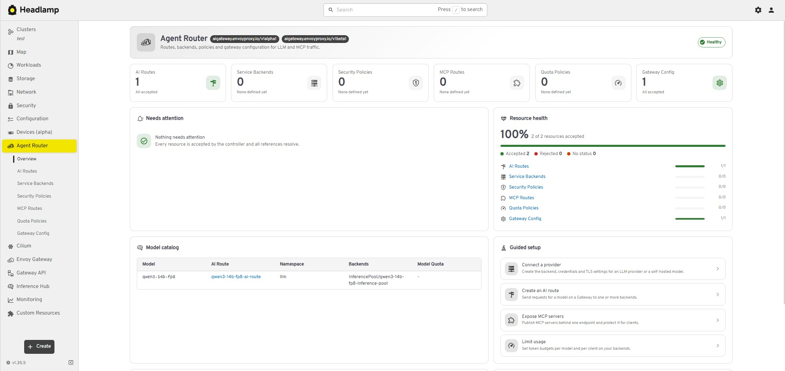
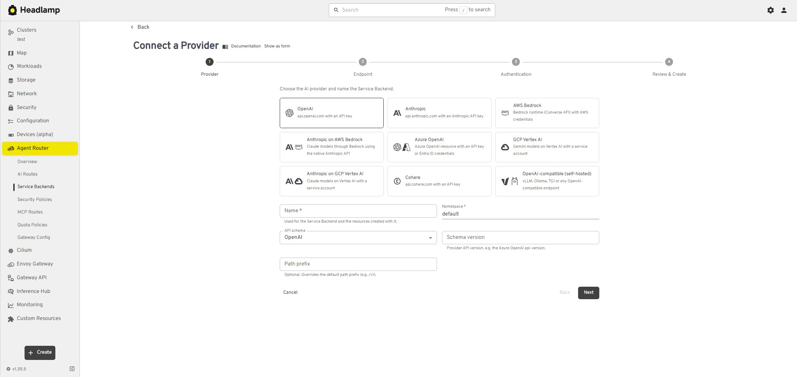
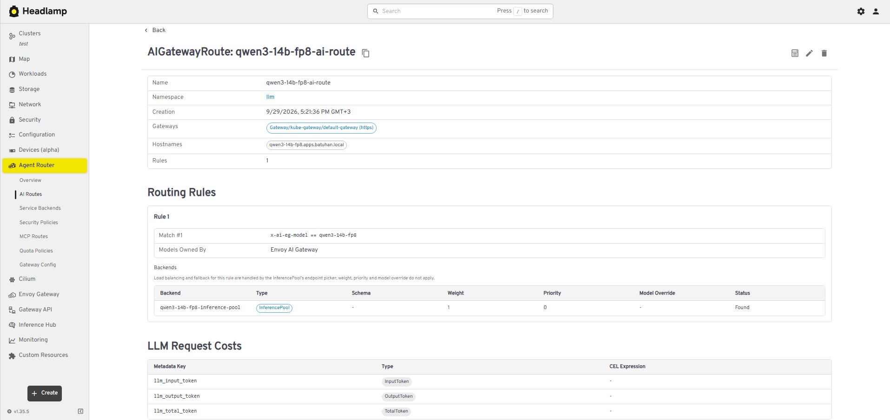

# Agent Router — Headlamp plugin

[English](#english) | [Türkçe](#türkçe)

---

## English

A [Headlamp](https://headlamp.dev) plugin for
[Envoy AI Gateway / Agent Router](https://github.com/theagentrouter/agent-router)
(`aigateway.envoyproxy.io`). It adds an **Agent Router** section to the sidebar for managing LLM
and MCP traffic on Kubernetes.

| Menu              | CRD                     |
| ----------------- | ----------------------- |
| AI Routes         | `AIGatewayRoute`        |
| Service Backends  | `AIServiceBackend`      |
| Security Policies | `BackendSecurityPolicy` |
| MCP Routes        | `MCPRoute`              |
| Quota Policies    | `QuotaPolicy`           |
| Gateway Config    | `GatewayConfig`         |

### Features

- **Overview** — resource counts and health, a "needs attention" list (rejected resources, routes
  pointing at missing backends, duplicate security policies, quotas no route can match, …), model
  catalog, provider mix and shortcuts to the setup wizards.
- **List and detail views** for every kind, with cross-references between routes, backends,
  policies and gateways.
- **Wizards and forms** to create and edit every kind (for example "Connect a provider" creates
  the Secret, Envoy `Backend`, `BackendTLSPolicy`, `AIServiceBackend` and
  `BackendSecurityPolicy` in one go). Fields the form does not manage are preserved on edit.
- **Generated objects belong to their owner:** a credential Secret created by a wizard is owned by
  its BackendSecurityPolicy or MCPRoute, and the Envoy `Backend` and `BackendTLSPolicy` of "Connect
  a provider" by the AIServiceBackend (owner references), so deleting the owner deletes them too.
  An existing object with the same name is never overwritten: applying stops with an error, and the
  objects created so far are removed again when a later step fails. When a policy or route is
  edited, a Secret of its own that it no longer uses (for example the old one after a key rotation)
  is deleted. Secrets picked with "Use an existing Secret" are never changed.
- **Auto-discovery** in the wizards: Gateways and their listeners, Services and ports, Service
  Backends, InferencePools, Envoy Backends and Secrets are suggested or picked automatically.
- **YAML editor with documentation** — create from YAML or edit any object; a Documentation tab
  shows the CRD schema from the cluster (search, required fields, allowed values, limits, CEL
  rules).
- **API version discovery** at runtime (`v1alpha1` / `v1beta1`).
- **Works offline** — all icons and provider logos are bundled.

### Screenshots

**Overview**



**"Connect a provider" wizard**



**AI Route detail**



### Requirements

- Headlamp **0.45.0** or newer (desktop or in-cluster).
- Envoy AI Gateway / Agent Router CRDs installed in the cluster (tested against upstream API **v1.1.0**). `QuotaPolicy` also needs Envoy Gateway rate limiting with Redis.
- Envoy Gateway for `Backend` resources and Gateway API for `Gateway` / `BackendTLSPolicy`. `InferencePool` (`inference.networking.k8s.io`) is optional.
- The plugin uses the permissions of the signed-in user; the RBAC rules are listed in the [Permissions](#permissions) section.

### Installation

#### From the Headlamp plugin catalog (Artifact Hub)

The plugin is published on [Artifact Hub](https://artifacthub.io/packages/headlamp/batuhancikrikci-headlamp-plugins/agentrouter). In the Headlamp desktop app, open the plugin
catalog, search for **Agent Router** and install it. The catalog shows only official plugins by default; turn off **Only official plugins** in the
Plugin Catalog settings to see this plugin.

#### Manual installation

Download `agentrouter-<version>.tar.gz` from [GitHub Releases](https://github.com/batuhancikrikci/headlamp-plugins/releases), compare its SHA-256
checksum with the `.sha256` file and extract it into the Headlamp plugins directory:

| Platform | Plugins directory                                                                                       |
| -------- | ------------------------------------------------------------------------------------------------------- |
| Linux    | `~/.config/Headlamp/plugins/` (or `~/.local/share/Headlamp/plugins/` when it exists)                    |
| macOS    | `~/Library/Application Support/Headlamp/plugins/` (otherwise `~/Library/Preferences/Headlamp/plugins/`) |
| Windows  | `%APPDATA%\Headlamp\Config\plugins\` (or `%LOCALAPPDATA%\Headlamp\Data\plugins\` when it exists)        |

```bash
tar -xzf agentrouter-*.tar.gz -C ~/.config/Headlamp/plugins/
```

The directory must contain `agentrouter/main.js` and `agentrouter/package.json`. Reload Headlamp afterwards
(Ctrl+Shift+R / Cmd+Shift+R).

To confirm that the tarball was built from this repository by its release workflow, verify its
build provenance with the [GitHub CLI](https://cli.github.com):
`gh attestation verify agentrouter-<version>.tar.gz --repo batuhancikrikci/headlamp-plugins`.

#### From source

```bash
npm ci
npm run deploy        # icons, type-check, lint, tests, build, install
```

`npm run deploy` installs the plugin into the plugins directory of the Headlamp desktop app, found
the same way `headlamp-plugin start` finds it. Set `HEADLAMP_PLUGINS_DIR` to install somewhere
else, and use `npm run deploy:fast` to skip the checks. The previous version is replaced atomically,
and the script warns about other copies of the plugin that Headlamp might load instead.

#### In-cluster Headlamp

The plugin manager of the Headlamp Helm chart can install the plugin from Artifact Hub:

```yaml
pluginsManager:
  enabled: true
  configContent: |
    plugins:
      - name: agentrouter
        source: https://artifacthub.io/packages/headlamp/batuhancikrikci-headlamp-plugins/agentrouter
```

Without a `version` field the latest release is installed; add `version: <x.y.z>` under `source`
to pin one.

Alternatively, extract the tarball built by `npm run package` into the directory passed to the
Headlamp server with `-plugins-dir` (`/headlamp/plugins` in the official image), from an init
container or with a custom image:

```dockerfile
FROM node:20-alpine AS build
WORKDIR /plugin
COPY package.json package-lock.json ./
RUN npm ci
COPY . .
RUN npm run build && cp package.json dist/

FROM ghcr.io/headlamp-k8s/headlamp:v0.45.0
COPY --from=build /plugin/dist /headlamp/plugins/agentrouter
```

### Permissions

The plugin only uses the permissions of the signed-in user; it has no service account of its own.
Sections a user cannot access show an error or stay empty.

| Purpose                     | API group                     | Resources                                                                                                         | Verbs                                                         |
| --------------------------- | ----------------------------- | ----------------------------------------------------------------------------------------------------------------- | ------------------------------------------------------------- |
| View Agent Router resources | `aigateway.envoyproxy.io`     | `aigatewayroutes`, `aiservicebackends`, `backendsecuritypolicies`, `mcproutes`, `quotapolicies`, `gatewayconfigs` | `get`, `list`, `watch`                                        |
| Create, edit and delete     | `aigateway.envoyproxy.io`     | same as above                                                                                                     | `create`, `update`, `patch`, `delete`                         |
| Schema documentation        | `apiextensions.k8s.io`        | `customresourcedefinitions`                                                                                       | `get` (`list` as a fallback)                                  |
| Gateways and listeners      | `gateway.networking.k8s.io`   | `gateways`                                                                                                        | `list`, `watch`; `patch` for Gateway Config                   |
| Provider TLS                | `gateway.networking.k8s.io`   | `backendtlspolicies`                                                                                              | `get`, `create`, `update`, `patch`, `delete`                  |
| Envoy backends              | `gateway.envoyproxy.io`       | `backends`                                                                                                        | `get`, `list`, `watch`, `create`, `update`, `patch`, `delete` |
| InferencePools (optional)   | `inference.networking.k8s.io` | `inferencepools`                                                                                                  | `list`, `watch`                                               |
| Discovery in the wizards    | core (`""`)                   | `namespaces`, `services`, `configmaps`                                                                            | `list`, `watch`                                               |
| Provider credentials        | core (`""`)                   | `secrets`                                                                                                         | `get`, `list`, `watch`, `create`, `update`, `patch`, `delete` |

Read-only users only need the first row (plus `customresourcedefinitions` `get` for the
documentation tab). For the objects the wizards generate, `get` checks that a name is free, `patch`
links a new object to its owner and `delete` removes the objects created by a failed apply. Gateway Config attaches to Gateways through the
`aigateway.envoyproxy.io/gateway-config` annotation, which is why it needs `patch` on `gateways`.

### Configuration

The plugin has no settings of its own; it works with the permissions of the Kubernetes user.

### Compatibility

| Component                       | Version                                    |
| ------------------------------- | ------------------------------------------ |
| Headlamp                        | ≥ 0.45.0 (`@kinvolk/headlamp-plugin` 0.14) |
| Agent Router / Envoy AI Gateway | API v1.1.0 (`v1alpha1`, `v1beta1`)         |

API versions are discovered at runtime; the table lists the versions used during development and testing.

### Development

Requires Node.js **20.11+** and npm **10+**. In the plugin directory:

```bash
npm ci
npm start             # rebuilds on every change and copies the result into the local Headlamp
```

| Command                             | What it does                                              |
| ----------------------------------- | --------------------------------------------------------- |
| `npm start`                         | Watch mode; every build is copied into the local Headlamp |
| `npm run build`                     | Production bundle in `dist/`                              |
| `npm run check`                     | Type-check, lint and unit tests                           |
| `npm run tsc`                       | Type-check (strict)                                       |
| `npm run lint` / `npm run lint-fix` | ESLint, zero warnings allowed                             |
| `npm run format`                    | Prettier                                                  |
| `npm test`                          | Vitest unit tests                                         |
| `npm run storybook`                 | Component stories                                         |
| `npm run package`                   | `agentrouter-<version>.tar.gz` for distribution           |
| `npm run deploy` / `deploy:fast`    | Build and install into the local Headlamp desktop app     |

Icons are bundled, so the plugin works without internet access: `npm run icons` collects every
`mdi:` and `simple-icons:` id used in `src/` into `src/icons/bundle.json` (`start`, `build`,
`package` and `storybook` run it first).

`src/common/` holds the building blocks shared by every plugin of this repository (states, error
boundary, CRD documentation, form fields, editor and wizards). The copies are identical in every
plugin; `src/plugin.ts` describes this plugin to them.

#### Project layout

```text
src/
  index.tsx                 Sidebar entries, routes and header actions of every kind
  plugin.ts                 Identity of the plugin, used by src/common
  routes.ts                 Route names and paths
  common/                   Shared building blocks, identical in every plugin of this repository
  icons/                    Plugin icon and provider logos, generated icon bundle
  resources/                KubeObject classes and types of the Agent Router CRDs
  utils/                    Pure, unit-tested logic: forms, templates, cross references, header actions
  components/
    common/                 Shared views, form fields, wizard shell, multi-document YAML editor
    dashboard/              Overview dashboard
    docs/                   Introductions of the documented kinds
    aiGatewayRoute/ aiServiceBackend/ backendSecurityPolicy/ mcpRoute/ quotaPolicy/ gatewayConfig/
                            List, detail and create / edit wizard per kind
scripts/
  build-icons.mjs           Offline icon bundle (src/icons/bundle.json)
  deploy.mjs                Build and install into the local Headlamp desktop app
```

### License

Licensed under the [Apache License 2.0](LICENSE). Third-party components and trademark notices are listed in [NOTICE](NOTICE).

This is an independent project; it is not affiliated with or endorsed by the Headlamp project or the projects it works with. Kubernetes, Headlamp, Envoy, Envoy Gateway, Envoy AI Gateway, Agent Router and the names and logos of the AI providers are trademarks of their respective owners and are used only to identify the software this plugin works with. The package logo is based on the Agent Router logo and is used for the same purpose only.

### Contributing

Open an [issue](https://github.com/batuhancikrikci/headlamp-plugins/issues) for bugs and ideas. The contribution guidelines are in [CONTRIBUTING.md](../CONTRIBUTING.md) and security reports are handled as described in [SECURITY.md](../SECURITY.md).

---

## Türkçe

[Envoy AI Gateway / Agent Router](https://github.com/theagentrouter/agent-router)
(`aigateway.envoyproxy.io`) için bir [Headlamp](https://headlamp.dev) eklentisi. Kenar çubuğuna
Kubernetes üzerinde LLM ve MCP trafiğini yönetmek için bir **Agent Router** bölümü ekler.

| Menü              | CRD                     |
| ----------------- | ----------------------- |
| AI Routes         | `AIGatewayRoute`        |
| Service Backends  | `AIServiceBackend`      |
| Security Policies | `BackendSecurityPolicy` |
| MCP Routes        | `MCPRoute`              |
| Quota Policies    | `QuotaPolicy`           |
| Gateway Config    | `GatewayConfig`         |

### Özellikler

- **Genel bakış** — kaynak sayıları ve sağlık durumu; "dikkat edilmesi gerekenler" listesi (reddedilen
  kaynaklar, eksik backend'lere işaret eden route'lar, yinelenen güvenlik politikaları, hiçbir route'un
  eşleşemediği kotalar, …), model kataloğu, sağlayıcı dağılımı ve kurulum sihirbazlarına kısayollar.
- Her tür için **liste ve detay görünümleri**; route, backend, politika ve gateway'ler arasında
  çapraz referanslar.
- Her türü oluşturmak ve düzenlemek için **sihirbazlar ve formlar** (örneğin "Connect a provider"
  Secret, Envoy `Backend`, `BackendTLSPolicy`, `AIServiceBackend` ve `BackendSecurityPolicy`
  nesnelerini tek seferde oluşturur). Formun yönetmediği alanlar düzenlemede korunur.
- **Üretilen nesneler üst kaynağa bağlanır (owner reference):** sihirbazın oluşturduğu kimlik bilgisi Secret'ı ait olduğu
  BackendSecurityPolicy'ye ya da MCPRoute'a, "Connect a provider" adımındaki Envoy `Backend` ve
  `BackendTLSPolicy` nesneleri ise AIServiceBackend'e bağlanır; üst nesne silindiğinde
  bu bağımlılıklar da otomatik olarak silinir. Aynı ada sahip mevcut bir nesnenin üzerine asla yazılmaz: işlem hata vererek durdurulur ve
  ara adımlardan biri başarısız olursa o ana kadar oluşturulan geçici nesneler otomatik olarak temizlenir (rollback). Bir politika ya da
  route düzenlendiğinde, ilgili kaynağa ait olup artık kullanılmayan Secret'lar (örneğin anahtar yenileme sonrası eskiyen Secret)
  silinir. "Use an existing Secret" seçeneğiyle belirlenen Secret'lara hiçbir zaman dokunulmaz.
- Sihirbazlarda **otomatik keşif**: Gateway'ler ve listener'lar, servisler ve portları, Service
  Backend'ler, InferencePool'lar, Envoy Backend'ler ve Secret'lar önerilir ya da otomatik seçilir.
- **Entegre dokümantasyon desteği sunan YAML editörü** — YAML üzerinden kaynak oluşturun ya da mevcut nesneleri düzenleyin; Documentation
  sekmesi kümedeki canlı CRD şemasını görüntüler (arama, zorunlu alanlar, izin verilen değerler, limitler ve
  CEL kuralları).
- Çalışma zamanında **API sürümü keşfi** (`v1alpha1` / `v1beta1`).
- **Çevrimdışı çalışır** — tüm ikonlar ve sağlayıcı logoları pakete gömülüdür.

### Ekran görüntüleri

**Genel bakış**


**"Connect a provider" sihirbazı**


**AI Route detayı**


### Gereksinimler

- Headlamp **0.45.0** veya üstü (masaüstü ya da küme içi).
- Kümede kurulu Envoy AI Gateway / Agent Router CRD'leri (upstream API **v1.1.0** ile test edildi). `QuotaPolicy` ayrıca Redis ile Envoy Gateway hız sınırlaması gerektirir.
- `Backend` kaynakları için Envoy Gateway, `Gateway` / `BackendTLSPolicy` için Gateway API. `InferencePool` (`inference.networking.k8s.io`) isteğe bağlıdır.
- Eklenti oturum açmış kullanıcının yetkileriyle çalışır; gerekli RBAC kuralları [Yetkiler](#yetkiler) bölümünde.

### Kurulum

#### Headlamp eklenti kataloğundan (Artifact Hub)

Eklenti [Artifact Hub](https://artifacthub.io/packages/headlamp/batuhancikrikci-headlamp-plugins/agentrouter) üzerinde yayınlanır. Headlamp masaüstü uygulamasında eklenti
kataloğunu açın, **Agent Router** araması yapın ve eklentiyi kurun. Katalog varsayılan olarak yalnızca resmî (official) eklentileri gösterir; bu eklentiyi görmek için
Plugin Catalog ayarlarında **Only official plugins** seçeneğini kapatın.

#### Elle kurulum

[GitHub Releases](https://github.com/batuhancikrikci/headlamp-plugins/releases) sayfasından `agentrouter-<sürüm>.tar.gz` dosyasını indirin, SHA-256
sağlama toplamını (checksum) `.sha256` dosyasıyla doğrulayın ve Headlamp eklenti dizinine açın:

| Platform | Eklenti dizini                                                                                      |
| -------- | --------------------------------------------------------------------------------------------------- |
| Linux    | `~/.config/Headlamp/plugins/` (varsa `~/.local/share/Headlamp/plugins/`)                            |
| macOS    | `~/Library/Application Support/Headlamp/plugins/` (yoksa `~/Library/Preferences/Headlamp/plugins/`) |
| Windows  | `%APPDATA%\Headlamp\Config\plugins\` (varsa `%LOCALAPPDATA%\Headlamp\Data\plugins\`)                |

```bash
tar -xzf agentrouter-*.tar.gz -C ~/.config/Headlamp/plugins/
```

Dizinde `agentrouter/main.js` ve `agentrouter/package.json` bulunmalıdır. Ardından Headlamp'i yeniden
yükleyin (Ctrl+Shift+R / Cmd+Shift+R).

Paketin bu depodaki sürüm iş akışıyla derlendiğini, derleme kaynağı kanıtını
[GitHub CLI](https://cli.github.com) ile denetleyerek doğrulayabilirsiniz:
`gh attestation verify agentrouter-<sürüm>.tar.gz --repo batuhancikrikci/headlamp-plugins`.

#### Kaynaktan kurulum

```bash
npm ci
npm run deploy        # ikonlar, tip denetimi, lint, testler, derleme, kurulum
```

`npm run deploy` eklentiyi Headlamp masaüstü uygulamasının eklenti dizinine, `headlamp-plugin start`
ile aynı kuralla bulduğu dizine kurar. Başka bir dizin için `HEADLAMP_PLUGINS_DIR` ayarlayın;
denetimleri atlamak için `npm run deploy:fast` kullanın. Önceki sürüm atomik olarak değiştirilir ve
betik, Headlamp'in onun yerine yükleyebileceği başka kopyalar hakkında uyarır.

#### Küme içi Headlamp

Headlamp Helm chart'ının eklenti yöneticisiyle eklenti Artifact Hub'dan kurulabilir:

```yaml
pluginsManager:
  enabled: true
  configContent: |
    plugins:
      - name: agentrouter
        source: https://artifacthub.io/packages/headlamp/batuhancikrikci-headlamp-plugins/agentrouter
```

`version` alanı yazılmazsa en son sürüm kurulur; bir sürümü sabitlemek için `source` altına
`version: <x.y.z>` ekleyin.

Ya da `npm run package` ile üretilen tarball'ı Headlamp sunucusuna `-plugins-dir` ile verilen dizine
(resmî imajda `/headlamp/plugins`) bir init container ile veya özel bir imajla açın:

```dockerfile
FROM node:20-alpine AS build
WORKDIR /plugin
COPY package.json package-lock.json ./
RUN npm ci
COPY . .
RUN npm run build && cp package.json dist/

FROM ghcr.io/headlamp-k8s/headlamp:v0.45.0
COPY --from=build /plugin/dist /headlamp/plugins/agentrouter
```

### Yetkiler

Eklenti yalnızca oturum açmış kullanıcının yetkilerini kullanır; kendine ait bir servis hesabı
yoktur. Kullanıcının erişemediği bölümler hata gösterir ya da boş kalır.

| Amaç                                  | API grubu                     | Kaynaklar                                                                                                         | İzin Verilen Eylemler (Verbs)                                 |
| ------------------------------------- | ----------------------------- | ----------------------------------------------------------------------------------------------------------------- | ------------------------------------------------------------- |
| Agent Router kaynaklarını görüntüleme | `aigateway.envoyproxy.io`     | `aigatewayroutes`, `aiservicebackends`, `backendsecuritypolicies`, `mcproutes`, `quotapolicies`, `gatewayconfigs` | `get`, `list`, `watch`                                        |
| Oluşturma, düzenleme ve silme         | `aigateway.envoyproxy.io`     | yukarıdakilerin aynısı                                                                                            | `create`, `update`, `patch`, `delete`                         |
| Şema dokümantasyonu                   | `apiextensions.k8s.io`        | `customresourcedefinitions`                                                                                       | `get` (yedek olarak `list`)                                   |
| Gateway'ler ve dinleyiciler           | `gateway.networking.k8s.io`   | `gateways`                                                                                                        | `list`, `watch`; Gateway Config için `patch`                  |
| Sağlayıcı TLS                         | `gateway.networking.k8s.io`   | `backendtlspolicies`                                                                                              | `get`, `create`, `update`, `patch`, `delete`                  |
| Envoy backend'leri                    | `gateway.envoyproxy.io`       | `backends`                                                                                                        | `get`, `list`, `watch`, `create`, `update`, `patch`, `delete` |
| InferencePool'lar (isteğe bağlı)      | `inference.networking.k8s.io` | `inferencepools`                                                                                                  | `list`, `watch`                                               |
| Sihirbazlarda keşif                   | core (`""`)                   | `namespaces`, `services`, `configmaps`                                                                            | `list`, `watch`                                               |
| Sağlayıcı kimlik bilgileri            | core (`""`)                   | `secrets`                                                                                                         | `get`, `list`, `watch`, `create`, `update`, `patch`, `delete` |

Salt okunur kullanıcılara yalnızca ilk satır yeterlidir (dokümantasyon sekmesi için ayrıca
`customresourcedefinitions` üzerinde `get` yetkisi gerekir). Sihirbazların ürettiği nesnelerde `get` ad
çakışmasını denetler, `patch` yeni nesneyi sahibine bağlar, `delete` ise işlemin başarısız olması durumunda
oluşturulan geçici kaynakları geri alır (rollback). Gateway Config, Gateway'lere
`aigateway.envoyproxy.io/gateway-config` annotation'ı ile bağlandığı için `gateways` üzerinde
`patch` gerektirir.

### Yapılandırma

Eklentinin ayrı bir yapılandırması yoktur; Kubernetes kullanıcısının yetkileriyle çalışır.

### Uyumluluk

| Bileşen                         | Sürüm                                      |
| ------------------------------- | ------------------------------------------ |
| Headlamp                        | ≥ 0.45.0 (`@kinvolk/headlamp-plugin` 0.14) |
| Agent Router / Envoy AI Gateway | API v1.1.0 (`v1alpha1`, `v1beta1`)         |

API sürümleri çalışma zamanında keşfedilir; tabloda geliştirme ve test sırasında kullanılan sürümler yer alır.

### Geliştirme

Node.js **20.11+** ve npm **10+** gerekir. Eklenti dizininde:

```bash
npm ci
npm start             # her değişiklikte derler ve sonucu yerel Headlamp'e kopyalar
```

| Komut                               | Ne yapar                                             |
| ----------------------------------- | ---------------------------------------------------- |
| `npm start`                         | İzleme modu; her derleme yerel Headlamp'e kopyalanır |
| `npm run build`                     | `dist/` altında üretim paketi                        |
| `npm run check`                     | Tip denetimi, lint ve birim testleri                 |
| `npm run tsc`                       | Tip denetimi (strict)                                |
| `npm run lint` / `npm run lint-fix` | ESLint, sıfır uyarı                                  |
| `npm run format`                    | Prettier                                             |
| `npm test`                          | Vitest birim testleri                                |
| `npm run storybook`                 | Bileşen hikâyeleri                                   |
| `npm run package`                   | Dağıtım için `agentrouter-<sürüm>.tar.gz`            |
| `npm run deploy` / `deploy:fast`    | Derleyip yerel Headlamp masaüstüne kurar             |

İkonlar pakete gömülüdür, eklenti internet erişimi olmadan çalışır: `npm run icons`, `src/` içinde
kullanılan her `mdi:` ve `simple-icons:` kimliğini `src/icons/bundle.json` dosyasına toplar
(`start`, `build`, `package` ve `storybook` komutları öncelikli olarak bu adımı çalıştırır).

`src/common/` bu depodaki tüm eklentilerde ortak olan yapı taşlarını içerir (durum ekranları, hata
yakalama, CRD dokümantasyonu, form alanları, editör ve sihirbazlar). Kopyalar her eklentide tamamen
aynıdır; `src/plugin.ts` bu eklentiyi onlara tanıtır.

#### Dosya yapısı

```text
src/
  index.tsx                 Her türün kenar çubuğu girdileri, rotaları ve başlık eylemleri
  plugin.ts                 Eklentinin kimliği (src/common tarafından kullanılır)
  routes.ts                 Rota adları ve yolları
  common/                   Ortak yapı taşları, bu depodaki tüm eklentilerde tamamen aynı
  icons/                    Eklenti ikonu, sağlayıcı logoları ve üretilen ikon paketi
  resources/                Agent Router CRD'lerinin KubeObject sınıfları ve tipleri
  utils/                    Saf, birim testli mantık: formlar, şablonlar, çapraz referanslar
  components/
    common/                 Ortak görünümler, form alanları, sihirbaz kabuğu, şema dokümantasyonlu YAML editörü
    dashboard/              Genel bakış panosu
    docs/                   Belgelenen türlerin tanıtımları
    aiGatewayRoute/ aiServiceBackend/ backendSecurityPolicy/ mcpRoute/ quotaPolicy/ gatewayConfig/
                            Tür başına liste, detay ve oluşturma / düzenleme sihirbazı
scripts/
  build-icons.mjs           Çevrimdışı ikon paketi (src/icons/bundle.json)
  deploy.mjs                Derler ve yerel Headlamp masaüstüne kurar
```

### Lisans

[Apache License 2.0](LICENSE) ile lisanslanmıştır. Üçüncü taraf bileşenler ve marka bildirimleri [NOTICE](NOTICE) dosyasındadır.

Bu bağımsız bir projedir; Headlamp projesiyle ya da birlikte çalıştığı projelerle bağlantılı değildir ve onlar tarafından onaylanmamıştır. Kubernetes, Headlamp, Envoy, Envoy Gateway, Envoy AI Gateway, Agent Router ile yapay zekâ sağlayıcılarının adları ve logoları ilgili sahiplerinin ticari markalarıdır; yalnızca eklentinin birlikte çalıştığı yazılımı tanımlamak için kullanılır. Paket logosu, Agent Router logosundan esinlenmiştir ve yalnızca aynı amaçla kullanılır.

### Katkıda bulunma

Hata bildirimleri ve öneriler için [issue](https://github.com/batuhancikrikci/headlamp-plugins/issues) açın. Katkı kuralları [CONTRIBUTING.md](../CONTRIBUTING.md), güvenlik bildirimleri [SECURITY.md](../SECURITY.md) içindedir.
