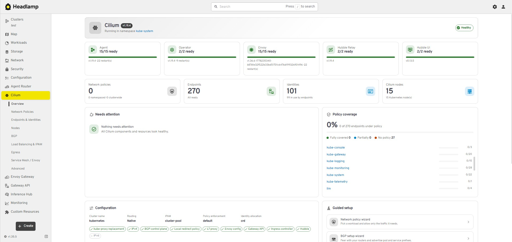
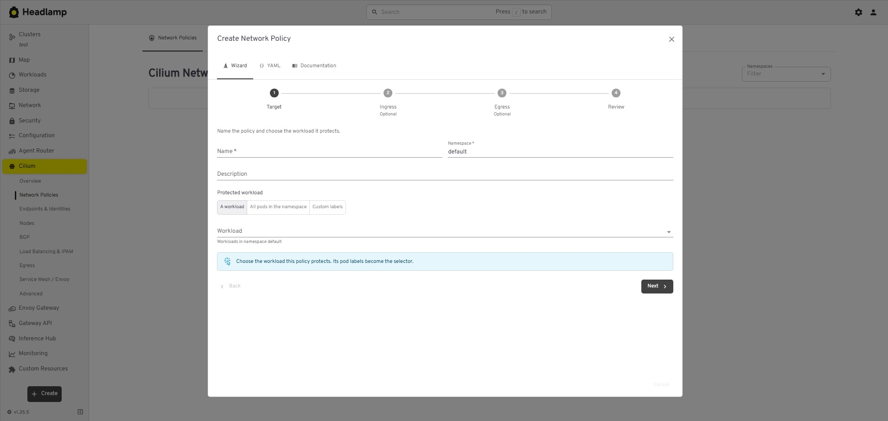
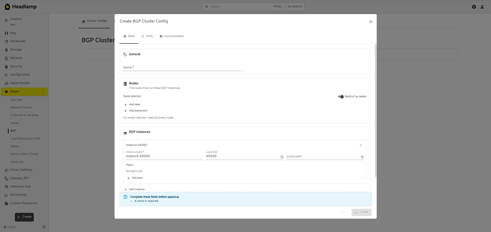

# Cilium — Headlamp plugin

[English](#english) | [Türkçe](#türkçe)

---

## English

A [Headlamp](https://headlamp.dev) plugin for operating [Cilium](https://cilium.io) from the
Kubernetes UI. It adds a **Cilium** section to the sidebar with a health overview, structured
views for every Cilium CRD, guided forms and wizards, and cross-references between Cilium
resources and the pods, namespaces, nodes and services they act on.

Target versions: **Headlamp ≥ 0.45.0** (`@kinvolk/headlamp-plugin` 0.14), vanilla Kubernetes with
**Cilium 1.20** as the CNI. API versions are discovered at runtime, so other Cilium releases work
as long as they serve the `cilium.io` API group.

### Features

| Area                     | What you get                                                                                                                                                                                                                                                        |
| ------------------------ | ------------------------------------------------------------------------------------------------------------------------------------------------------------------------------------------------------------------------------------------------------------------- |
| **Overview**             | Agent / operator / Envoy / Hubble pod health and version, features enabled in `cilium-config`, KPI tiles (policies, endpoints, policy coverage, identities, BGP sessions, LB IPs), a "Needs attention" list, policy coverage per namespace, resource counts per CRD |
| **Lists**                | Kind-specific columns (selectors, rule counts, feature chips, selected endpoints, session state, IP usage, …), filtering, namespace awareness, status indicators, row actions and bulk delete                                                                       |
| **Details**              | Structured sections instead of raw JSON, related resources, conditions and events                                                                                                                                                                                   |
| **Create / edit**        | Form, YAML and CRD documentation tabs in one dialog; form and YAML stay in sync in both directions; client-side validation                                                                                                                                          |
| **Wizards**              | Network policy, BGP setup, LoadBalancer IP pool + L2 announcement, egress gateway                                                                                                                                                                                   |
| **Policy visualization** | Allowed and denied ingress/egress per rule, with peers, ports and L7 rules                                                                                                                                                                                          |
| **Relationships**        | Policies ↔ selected endpoints, identities ↔ endpoints, CIDR groups ↔ policies, BGP cluster config ↔ peer config ↔ advertisement ↔ nodes, IP pools / L2 policies ↔ services, egress policies ↔ pods and gateway nodes                                                |
| **Native pages**         | A "Cilium" section on Headlamp's Pod, Namespace, Node and Service pages                                                                                                                                                                                             |
| **Resource map**         | Map sources for network policies, BGP, load balancing and egress gateways                                                                                                                                                                                           |
| **Robustness**           | Runtime API discovery, hidden or disabled views for missing CRDs, deprecation notices, loading / empty / error / forbidden states, an error boundary around every view                                                                                              |

The UI is English only.

#### Sidebar

| Entry                  | Tabs                                                                                                                     |
| ---------------------- | ------------------------------------------------------------------------------------------------------------------------ |
| Overview               | Dashboard                                                                                                                |
| Network Policies       | Network Policies, Clusterwide Policies, CIDR Groups                                                                      |
| Endpoints & Identities | Endpoints, Endpoint Slices, Identities                                                                                   |
| Nodes                  | Cilium Nodes, Node Configs                                                                                               |
| BGP                    | Cluster Configs, Peer Configs, Advertisements, Node Configs, Node Overrides, Peering Policies (legacy, only when served) |
| Load Balancing & IPAM  | LB IP Pools, L2 Announcements, Pod IP Pools                                                                              |
| Egress                 | Egress Gateways, Local Redirects                                                                                         |
| Service Mesh / Envoy   | Envoy Configs, Clusterwide Envoy Configs                                                                                 |
| Advanced               | API inventory, other `cilium.io` kinds, Hubble status                                                                    |

Each group is one page; the tab is part of the URL (`/cilium/policies/ciliumnetworkpolicies`), so
every list can be linked. Tabs of CRDs that are not installed are disabled with an explanation,
and a group disappears from the sidebar when none of its CRDs are installed.

#### Wizards

| Wizard                    | Where                                  | Creates                                                                                                                                                                                                                                                                                                                                                                                                    |
| ------------------------- | -------------------------------------- | ---------------------------------------------------------------------------------------------------------------------------------------------------------------------------------------------------------------------------------------------------------------------------------------------------------------------------------------------------------------------------------------------------------- |
| Network policy            | Network Policies → Create, Overview    | One `CiliumNetworkPolicy` or `CiliumClusterwideNetworkPolicy`: target chosen by workload (Deployment, StatefulSet or DaemonSet; its pod labels become the selector, with a live preview of the protected pods), or all pods, or custom labels, ingress and egress rules (endpoints, entities, CIDRs and CIDR groups, FQDNs, services, ports, HTTP and DNS rules, ICMP), review with visualization and YAML |
| BGP setup                 | BGP → Create menu, Overview            | `CiliumBGPAdvertisement`, `CiliumBGPPeerConfig` and `CiliumBGPClusterConfig`, wired together by name and label                                                                                                                                                                                                                                                                                             |
| IP pool + L2 announcement | Load Balancing → Create menu, Overview | `CiliumLoadBalancerIPPool` and, optionally, a `CiliumL2AnnouncementPolicy` for the same services                                                                                                                                                                                                                                                                                                           |
| Egress gateway            | Egress → Create, Overview              | One `CiliumEgressGatewayPolicy`: source pods (with a live preview), destinations, gateway node and source address                                                                                                                                                                                                                                                                                          |

Wizards that create several resources apply them in dependency order, stop at the first failure
and can be applied again.

### Screenshots

**Overview**



**Network policy wizard**



**BGP**



### Requirements

- Headlamp **0.45.0** or newer.
- Cilium as the CNI (developed against **1.20**; other releases that serve the `cilium.io` API group work too).
- The plugin uses the permissions of the signed-in user; example ClusterRoles for read-only and write access are in the [Permissions](#permissions) section.

### Supported CRDs

All kinds belong to the `cilium.io` API group. "Default version" is only what the plugin assumes
before discovery has run; the version actually used is the highest-priority version the cluster
serves for that resource (`v2` before `v2alpha1`).

| Kind                           | Scope      | Default version | Create / edit                                     |
| ------------------------------ | ---------- | --------------- | ------------------------------------------------- |
| CiliumNetworkPolicy            | Namespaced | v2              | Wizard, form, YAML                                |
| CiliumClusterwideNetworkPolicy | Cluster    | v2              | Wizard, form, YAML                                |
| CiliumCIDRGroup                | Cluster    | v2              | Form, YAML                                        |
| CiliumEndpoint                 | Namespaced | v2              | Read-only (runtime state)                         |
| CiliumEndpointSlice            | Cluster    | v2alpha1        | Read-only (runtime state)                         |
| CiliumIdentity                 | Cluster    | v2              | Read-only (runtime state)                         |
| CiliumNode                     | Cluster    | v2              | Read-only (runtime state)                         |
| CiliumNodeConfig               | Namespaced | v2              | Form, YAML                                        |
| CiliumBGPClusterConfig         | Cluster    | v2              | Setup wizard, form, YAML                          |
| CiliumBGPPeerConfig            | Cluster    | v2              | Setup wizard, form, YAML                          |
| CiliumBGPAdvertisement         | Cluster    | v2              | Setup wizard, form, YAML                          |
| CiliumBGPNodeConfig            | Cluster    | v2              | Read-only (generated by the operator)             |
| CiliumBGPNodeConfigOverride    | Cluster    | v2              | Form, YAML                                        |
| CiliumBGPPeeringPolicy         | Cluster    | v2alpha1        | **Deprecated**: shown only when served, YAML only |
| CiliumLoadBalancerIPPool       | Cluster    | v2              | Setup wizard, form, YAML                          |
| CiliumL2AnnouncementPolicy     | Cluster    | v2alpha1        | Setup wizard, form, YAML                          |
| CiliumPodIPPool                | Cluster    | v2alpha1        | Form, YAML                                        |
| CiliumEgressGatewayPolicy      | Cluster    | v2              | Wizard, form, YAML                                |
| CiliumLocalRedirectPolicy      | Namespaced | v2              | Form, YAML                                        |
| CiliumEnvoyConfig              | Namespaced | v2              | Form (Envoy resources as embedded YAML), YAML     |
| CiliumClusterwideEnvoyConfig   | Cluster    | v2              | Form (Envoy resources as embedded YAML), YAML     |

Any other kind served in `cilium.io` (for example a CRD added by a newer Cilium release) is listed
under **Advanced** with a generic list and detail page.

Read-only kinds still have Headlamp's standard YAML view, and delete where RBAC allows it; the
plugin just does not offer to create them or edit them with a form.

#### How versions and availability are detected

1. `GET /apis/cilium.io` lists the group versions; `GET /apis/cilium.io/<version>` lists the
   resources each version serves.
2. For every resource the most stable serving version is selected and written to the resource
   class before any request is made. Results are cached per cluster.
3. A resource that no version serves is treated as "CRD not installed".
4. Deprecation flags and storage versions are read from the CRD objects when the user is allowed
   to read them; otherwise the plugin falls back to its built-in list of deprecated kinds.

### Installation

#### From the Headlamp plugin catalog (Artifact Hub)

The plugin is published on [Artifact Hub](https://artifacthub.io/packages/headlamp/batuhancikrikci-headlamp-plugins/cilium). In the Headlamp desktop app, open the plugin
catalog, search for **Cilium** and install it. The catalog shows only official plugins by default; turn off **Only official plugins** in the
Plugin Catalog settings to see this plugin.

#### Manual installation

Download `cilium-<version>.tar.gz` from [GitHub Releases](https://github.com/batuhancikrikci/headlamp-plugins/releases), compare its SHA-256
checksum with the `.sha256` file and extract it into the Headlamp plugins directory:

| Platform | Plugins directory                                                                                       |
| -------- | ------------------------------------------------------------------------------------------------------- |
| Linux    | `~/.config/Headlamp/plugins/` (or `~/.local/share/Headlamp/plugins/` when it exists)                    |
| macOS    | `~/Library/Application Support/Headlamp/plugins/` (otherwise `~/Library/Preferences/Headlamp/plugins/`) |
| Windows  | `%APPDATA%\Headlamp\Config\plugins\` (or `%LOCALAPPDATA%\Headlamp\Data\plugins\` when it exists)        |

```bash
tar -xzf cilium-*.tar.gz -C ~/.config/Headlamp/plugins/
```

The directory must contain `cilium/main.js` and `cilium/package.json`. Reload Headlamp afterwards
(Ctrl+Shift+R / Cmd+Shift+R).

To confirm that the tarball was built from this repository by its release workflow, verify its
build provenance with the [GitHub CLI](https://cli.github.com):
`gh attestation verify cilium-<version>.tar.gz --repo batuhancikrikci/headlamp-plugins`.

#### From source

```bash
npm ci
npm run deploy        # icons, type-check, lint, tests, build, install
```

`npm run deploy` installs the plugin into the plugins directory of the Headlamp desktop app, found
the same way `headlamp-plugin start` finds it. Set `HEADLAMP_PLUGINS_DIR` to install somewhere
else, and use `npm run deploy:fast` to skip the checks. The previous version is replaced atomically,
and the script warns about other copies of the plugin that Headlamp might load instead.

#### In-cluster Headlamp

The plugin manager of the Headlamp Helm chart can install the plugin from Artifact Hub:

```yaml
pluginsManager:
  enabled: true
  configContent: |
    plugins:
      - name: cilium
        source: https://artifacthub.io/packages/headlamp/batuhancikrikci-headlamp-plugins/cilium
```

Without a `version` field the latest release is installed; add `version: <x.y.z>` under `source`
to pin one.

Alternatively, extract the tarball built by `npm run package` into the directory passed to the
Headlamp server with `-plugins-dir` (`/headlamp/plugins` in the official image), from an init
container or with a custom image:

```dockerfile
FROM node:20-alpine AS build
WORKDIR /plugin
COPY package.json package-lock.json ./
RUN npm ci
COPY . .
RUN npm run build && cp package.json dist/

FROM ghcr.io/headlamp-k8s/headlamp:v0.45.0
COPY --from=build /plugin/dist /headlamp/plugins/cilium
```

### Permissions

The plugin uses the permissions of the logged-in Headlamp user. Views degrade gracefully: a
missing permission shows a "not allowed" state for that part instead of failing the page, and
create / edit actions are hidden when the user lacks the verb.

Read-only access to everything the plugin shows:

```yaml
apiVersion: rbac.authorization.k8s.io/v1
kind: ClusterRole
metadata:
  name: headlamp-cilium-viewer
rules:
  # All Cilium resources.
  - apiGroups: ['cilium.io']
    resources: ['*']
    verbs: ['get', 'list', 'watch']
  # Objects Cilium resources are correlated with, the Cilium component pods and events.
  - apiGroups: ['']
    resources: ['pods', 'services', 'nodes', 'namespaces', 'events']
    verbs: ['get', 'list', 'watch']
  # L2 announcement leases (which node currently announces a service).
  - apiGroups: ['coordination.k8s.io']
    resources: ['leases']
    verbs: ['get', 'list', 'watch']
  # Optional: CRD documentation tab, storage versions and deprecation flags.
  - apiGroups: ['apiextensions.k8s.io']
    resources: ['customresourcedefinitions']
    verbs: ['get', 'list']
```

Reading the enabled features additionally needs `get` on the `cilium-config` ConfigMap in the
namespace Cilium runs in:

```yaml
apiVersion: rbac.authorization.k8s.io/v1
kind: Role
metadata:
  name: headlamp-cilium-config-reader
  namespace: kube-system # the namespace of the Cilium agent
rules:
  - apiGroups: ['']
    resources: ['configmaps']
    resourceNames: ['cilium-config']
    verbs: ['get']
```

To create, edit and delete with the forms and wizards, add the write verbs for the kinds users
should manage, for example:

```yaml
apiVersion: rbac.authorization.k8s.io/v1
kind: ClusterRole
metadata:
  name: headlamp-cilium-editor
rules:
  - apiGroups: ['cilium.io']
    resources:
      - ciliumnetworkpolicies
      - ciliumclusterwidenetworkpolicies
      - ciliumcidrgroups
      - ciliumnodeconfigs
      - ciliumbgpclusterconfigs
      - ciliumbgppeerconfigs
      - ciliumbgpadvertisements
      - ciliumbgpnodeconfigoverrides
      - ciliumloadbalancerippools
      - ciliuml2announcementpolicies
      - ciliumpodippools
      - ciliumegressgatewaypolicies
      - ciliumlocalredirectpolicies
      - ciliumenvoyconfigs
      - ciliumclusterwideenvoyconfigs
    verbs: ['create', 'update', 'patch', 'delete']
```

API discovery (`/apis/cilium.io`) and permission checks (`SelfSubjectAccessReview`) are available
to every authenticated user by default (`system:discovery`, `system:basic-user`).

### Configuration

The plugin has no settings of its own; it works with the permissions of the Kubernetes user.

### Compatibility

| Component | Version                                    |
| --------- | ------------------------------------------ |
| Headlamp  | ≥ 0.45.0 (`@kinvolk/headlamp-plugin` 0.14) |
| Cilium    | 1.20 (`cilium.io` v2, v2alpha1)            |

API versions are discovered at runtime; the table lists the versions used during development and testing.

### Notes and limitations

- **Validation** in the forms catches common mistakes early. The API server and Cilium remain the
  source of truth; their errors are shown in the dialog when applying.
- **Fields without a form control** (for example Kafka rules, `fromGroups`, service selectors in
  `toServices`, BGP auto-discovery, `egressGateways` lists) are edited in the YAML tab and are
  preserved when the object is edited with the form.
- **Policy selection** (which endpoints a policy selects, and the reverse) is computed in the
  browser from the endpoint identity labels with Cilium's selector semantics. Policy enforcement
  shown for an endpoint comes from the endpoint status reported by the agent.
- **Policy coverage** counts an endpoint as covered when Cilium enforces ingress or egress policy
  for it. Standard Kubernetes `NetworkPolicy` objects enforced by Cilium are reflected in that
  status too, but are not listed by this plugin.
- **Endpoint slices**: when Cilium runs with `enable-cilium-endpoint-slice`, agents consume
  slices, but `CiliumEndpoint` objects still exist and are what the relationship views use.
- **Hubble**: the plugin shows whether Hubble Relay and Hubble UI are deployed and links to the UI
  service. Flows are not shown, because they are only available over the Hubble Relay gRPC API.
- **Envoy resources** are free-form xDS and are edited as YAML; they are not validated beyond
  requiring an `@type`.
- **Large clusters**: relationship views list endpoints, pods and services of the whole cluster
  (or of one namespace where the scope allows it) and match them in the browser.

### Development

Requires Node.js **20.11+** and npm **10+**. In the plugin directory:

```bash
npm ci
npm start             # rebuilds on every change and copies the result into the local Headlamp
```

| Command                             | What it does                                              |
| ----------------------------------- | --------------------------------------------------------- |
| `npm start`                         | Watch mode; every build is copied into the local Headlamp |
| `npm run build`                     | Production bundle in `dist/`                              |
| `npm run check`                     | Type-check, lint and unit tests                           |
| `npm run tsc`                       | Type-check (strict)                                       |
| `npm run lint` / `npm run lint-fix` | ESLint, zero warnings allowed                             |
| `npm run format`                    | Prettier                                                  |
| `npm test`                          | Vitest unit tests                                         |
| `npm run storybook`                 | Component stories                                         |
| `npm run package`                   | `cilium-<version>.tar.gz` for distribution                |
| `npm run deploy` / `deploy:fast`    | Build and install into the local Headlamp desktop app     |

Icons are bundled, so the plugin works without internet access: `npm run icons` collects every
`mdi:` and `simple-icons:` id used in `src/` into `src/icons/bundle.json` (`start`, `build`,
`package` and `storybook` run it first).

`src/common/` holds the building blocks shared by every plugin of this repository (states, error
boundary, CRD documentation, form fields, editor and wizards). The copies are identical in every
plugin; `src/plugin.ts` describes this plugin to them.

#### Project layout

```text
src/
  index.tsx                 Sidebar entries, routes, kind icons, native sections, map sources
  plugin.ts                 Identity of the plugin, used by src/common
  routes.ts                 Route names that are not derived from the CRD registry
  common/                   Shared building blocks, identical in every plugin of this repository
  icons/                    Sidebar and kind icon, generated icon bundle
  api/
    availability.ts         Pure model of API discovery and CRD metadata
    discovery.ts            Fetching and caching of the served versions per cluster
    ciliumInstall.ts        Component pods, versions and cilium-config features
  resources/
    types.ts, kinds.ts      Shared types and kind scopes (no Headlamp runtime imports)
    models/                 Typed JSON models and pure helpers per area (policy, runtime, bgp, network)
    *.ts                    KubeObject classes per area, base class, CRD registry
    generic.ts              Runtime-built classes for cilium.io kinds without dedicated views
  hooks/                    Discovery, list and installation hooks
  utils/                    Pure, unit-tested logic: selectors, CIDR math, policy matching,
                            policy view model, relationships, validation, templates
  components/
    common/                 List/detail/group page wrappers, CRD gate, shared presentation
    common/form/            Selector editors and create / edit actions
    policies/ endpoints/ nodes/ bgp/ lb/ egress/ envoy/
                            Lists, details, forms and wizards per sidebar group
    overview/               Dashboard and its aggregation logic
    advanced/               API inventory and generic views
    editing.ts              Which form and wizards each kind offers
  integrations/             Sections on native Pod/Namespace/Node/Service pages, map sources
scripts/
  build-icons.mjs           Offline icon bundle (src/icons/bundle.json)
  deploy.mjs                Build and install into the local Headlamp desktop app
```

### License

Licensed under the [Apache License 2.0](LICENSE). Third-party components and trademark notices are listed in [NOTICE](NOTICE).

This is an independent project; it is not affiliated with or endorsed by the Headlamp project or the projects it works with. Kubernetes, Headlamp, Cilium and Hubble are trademarks of their respective owners and are used only to identify the software this plugin works with.

### Contributing

Open an [issue](https://github.com/batuhancikrikci/headlamp-plugins/issues) for bugs and ideas. The contribution guidelines are in [CONTRIBUTING.md](../CONTRIBUTING.md) and security reports are handled as described in [SECURITY.md](../SECURITY.md).

---

## Türkçe

[Cilium](https://cilium.io)'u Kubernetes arayüzünden yönetmek için bir [Headlamp](https://headlamp.dev)
eklentisi. Kenar çubuğuna sağlık özeti, her Cilium CRD'si için yapılandırılmış görünümler, rehberli
formlar ve sihirbazlar ile Cilium kaynakları ve etkiledikleri pod, namespace, node ve service'ler
arasında çapraz referanslar içeren bir **Cilium** bölümü ekler.

Hedef sürümler: **Headlamp ≥ 0.45.0** (`@kinvolk/headlamp-plugin` 0.14), CNI olarak **Cilium 1.20**
kullanan vanilla Kubernetes. API sürümleri çalışma zamanında keşfedilir; bu yüzden `cilium.io` API
grubunu sunan diğer Cilium sürümleri de çalışır.

### Özellikler

| Alan                        | Neler sunar                                                                                                                                                                                                                                                                                       |
| --------------------------- | ------------------------------------------------------------------------------------------------------------------------------------------------------------------------------------------------------------------------------------------------------------------------------------------------- |
| **Genel bakış**             | Agent / operator / Envoy / Hubble pod sağlığı ve sürümü, `cilium-config` içinde açık özellikler, KPI kutuları (politikalar, endpoint'ler, politika kapsamı, kimlikler, BGP oturumları, LB IP'leri), "dikkat gerektirenler" listesi, namespace başına politika kapsamı, CRD başına kaynak sayıları |
| **Listeler**                | Türe özgü sütunlar (seçiciler, kural sayıları, özellik chip'leri, seçilen endpoint'ler, oturum durumu, IP kullanımı, …), filtreleme, namespace farkındalığı, durum göstergeleri, satır eylemleri ve toplu silme                                                                                   |
| **Detaylar**                | Ham JSON yerine yapılandırılmış bölümler, ilgili kaynaklar, koşullar ve olaylar                                                                                                                                                                                                                   |
| **Oluşturma / düzenleme**   | Tek pencerede form, YAML ve CRD dokümantasyonu sekmeleri; form ve YAML iki yönlü senkron; istemci tarafı doğrulama                                                                                                                                                                                |
| **Sihirbazlar**             | Ağ politikası, BGP kurulumu, LoadBalancer IP havuzu + L2 duyurusu, egress gateway                                                                                                                                                                                                                 |
| **Politika görselleştirme** | Kural başına izin verilen ve reddedilen ingress/egress; eşler, portlar ve L7 kurallarıyla                                                                                                                                                                                                         |
| **İlişkiler**               | Politikalar ↔ seçilen endpoint'ler, kimlikler ↔ endpoint'ler, CIDR grupları ↔ politikalar, BGP cluster config ↔ peer config ↔ advertisement ↔ node'lar, IP havuzları / L2 politikaları ↔ service'ler, egress politikaları ↔ pod'lar ve gateway node'ları                                          |
| **Yerel sayfalar**          | Headlamp'in Pod, Namespace, Node ve Service sayfalarında bir "Cilium" bölümü                                                                                                                                                                                                                      |
| **Resource map**            | Ağ politikaları, BGP, yük dengeleme ve egress gateway'ler için harita kaynakları                                                                                                                                                                                                                  |
| **Dayanıklılık**            | Çalışma zamanında API keşfi, eksik CRD'ler için gizlenen veya devre dışı görünümler, kullanımdan kaldırılma (deprecation) uyarıları, yükleniyor / boş / hata / yetki yok durumları, her görünümün etrafında hata yakalama                                                                        |

Arayüz yalnızca İngilizcedir.

#### Kenar çubuğu

| Girdi                  | Sekmeler                                                                                                                   |
| ---------------------- | -------------------------------------------------------------------------------------------------------------------------- |
| Overview               | Pano                                                                                                                       |
| Network Policies       | Network Policies, Clusterwide Policies, CIDR Groups                                                                        |
| Endpoints & Identities | Endpoints, Endpoint Slices, Identities                                                                                     |
| Nodes                  | Cilium Nodes, Node Configs                                                                                                 |
| BGP                    | Cluster Configs, Peer Configs, Advertisements, Node Configs, Node Overrides, Peering Policies (eski; yalnızca sunuluyorsa) |
| Load Balancing & IPAM  | LB IP Pools, L2 Announcements, Pod IP Pools                                                                                |
| Egress                 | Egress Gateways, Local Redirects                                                                                           |
| Service Mesh / Envoy   | Envoy Configs, Clusterwide Envoy Configs                                                                                   |
| Advanced               | API envanteri, diğer `cilium.io` türleri, Hubble durumu                                                                    |

Her grup tek bir sayfadır; sekme URL'nin parçasıdır (`/cilium/policies/ciliumnetworkpolicies`),
böylece her listeye bağlantı verilebilir. Kurulu olmayan CRD'lerin sekmeleri bilgilendirme mesajıyla devre dışı
bırakılır; hiçbir CRD'si kurulu olmayan gruplar ise kenar çubuğundan gizlenir.

#### Sihirbazlar

| Sihirbaz                | Nerede                                   | Oluşturur                                                                                                                                                                                                                                                                                                                                                                                                                                  |
| ----------------------- | ---------------------------------------- | ------------------------------------------------------------------------------------------------------------------------------------------------------------------------------------------------------------------------------------------------------------------------------------------------------------------------------------------------------------------------------------------------------------------------------------------ |
| Ağ politikası           | Network Policies → Create, Overview      | Tek bir `CiliumNetworkPolicy` veya `CiliumClusterwideNetworkPolicy`: hedef bir iş yüküne (Deployment, StatefulSet veya DaemonSet; pod etiketleri seçici olur, korunan pod'ların canlı önizlemesiyle), tüm pod'lara ya da özel etiketlere göre seçilir; ingress ve egress kuralları (endpoint'ler, entity'ler, CIDR'lar ve CIDR grupları, FQDN'ler, service'ler, portlar, HTTP ve DNS kuralları, ICMP); görselleştirme ve YAML ile inceleme |
| BGP kurulumu            | BGP → Create menüsü, Overview            | Ad ve etiketle birbirine bağlanan `CiliumBGPAdvertisement`, `CiliumBGPPeerConfig` ve `CiliumBGPClusterConfig`                                                                                                                                                                                                                                                                                                                              |
| IP havuzu + L2 duyurusu | Load Balancing → Create menüsü, Overview | `CiliumLoadBalancerIPPool` ve isteğe bağlı olarak aynı service'ler için bir `CiliumL2AnnouncementPolicy`                                                                                                                                                                                                                                                                                                                                   |
| Egress gateway          | Egress → Create, Overview                | Tek bir `CiliumEgressGatewayPolicy`: kaynak pod'lar (canlı önizlemeyle), hedefler, gateway node'u ve kaynak adres                                                                                                                                                                                                                                                                                                                          |

Birden fazla kaynak oluşturan sihirbazlar işlemleri bağımlılık sırasına göre yürütür; herhangi bir adımda hata oluşursa işlem anında durdurulur ve
düzeltme sonrası güvenle tekrar çalıştırılabilir (idempotent).

### Ekran görüntüleri

**Genel bakış**


**Ağ politikası sihirbazı**


**BGP**


### Gereksinimler

- Headlamp **0.45.0** veya üstü.
- CNI olarak Cilium (**1.20** ile geliştirildi; `cilium.io` API grubunu sunan diğer sürümler de çalışır).
- Eklenti oturum açmış kullanıcının yetkileriyle çalışır; salt okunur ve yazma için örnek ClusterRole'ler [Yetkiler](#yetkiler) bölümünde.

### Desteklenen CRD'ler

Tüm türler `cilium.io` API grubundadır. "Varsayılan sürüm", keşif tamamlanmadan önce eklentinin
varsaydığı sürümdür; gerçekte kullanılan sürüm, kümenin o kaynak için sunduğu en yüksek öncelikli
sürümdür (`v2alpha1`'den önce `v2`).

| Tür                            | Kapsam     | Varsayılan sürüm | Oluşturma / düzenleme                                                  |
| ------------------------------ | ---------- | ---------------- | ---------------------------------------------------------------------- |
| CiliumNetworkPolicy            | Namespaced | v2               | Sihirbaz, form, YAML                                                   |
| CiliumClusterwideNetworkPolicy | Cluster    | v2               | Sihirbaz, form, YAML                                                   |
| CiliumCIDRGroup                | Cluster    | v2               | Form, YAML                                                             |
| CiliumEndpoint                 | Namespaced | v2               | Salt okunur (çalışma durumu)                                           |
| CiliumEndpointSlice            | Cluster    | v2alpha1         | Salt okunur (çalışma durumu)                                           |
| CiliumIdentity                 | Cluster    | v2               | Salt okunur (çalışma durumu)                                           |
| CiliumNode                     | Cluster    | v2               | Salt okunur (çalışma durumu)                                           |
| CiliumNodeConfig               | Namespaced | v2               | Form, YAML                                                             |
| CiliumBGPClusterConfig         | Cluster    | v2               | Kurulum sihirbazı, form, YAML                                          |
| CiliumBGPPeerConfig            | Cluster    | v2               | Kurulum sihirbazı, form, YAML                                          |
| CiliumBGPAdvertisement         | Cluster    | v2               | Kurulum sihirbazı, form, YAML                                          |
| CiliumBGPNodeConfig            | Cluster    | v2               | Salt okunur (operatör üretir)                                          |
| CiliumBGPNodeConfigOverride    | Cluster    | v2               | Form, YAML                                                             |
| CiliumBGPPeeringPolicy         | Cluster    | v2alpha1         | **Kullanımdan kaldırıldı (Deprecated)**: yalnızca sunuluyorsa gösterilir, yalnızca YAML |
| CiliumLoadBalancerIPPool       | Cluster    | v2               | Kurulum sihirbazı, form, YAML                                          |
| CiliumL2AnnouncementPolicy     | Cluster    | v2alpha1         | Kurulum sihirbazı, form, YAML                                          |
| CiliumPodIPPool                | Cluster    | v2alpha1         | Form, YAML                                                             |
| CiliumEgressGatewayPolicy      | Cluster    | v2               | Sihirbaz, form, YAML                                                   |
| CiliumLocalRedirectPolicy      | Namespaced | v2               | Form, YAML                                                             |
| CiliumEnvoyConfig              | Namespaced | v2               | Form (Envoy kaynakları gömülü YAML olarak), YAML                       |
| CiliumClusterwideEnvoyConfig   | Cluster    | v2               | Form (Envoy kaynakları gömülü YAML olarak), YAML                       |

`cilium.io` grubunda sunulan diğer türler (örneğin yeni bir Cilium sürümünün eklediği bir CRD)
**Advanced** altında genel bir liste ve detay sayfasıyla listelenir.

Salt okunur türlerde Headlamp'in standart YAML görünümü ve RBAC izin veriyorsa silme yine
kullanılabilir; eklenti yalnızca bunları oluşturmayı veya formla düzenlemeyi sunmaz.

#### Sürümler ve kullanılabilirlik nasıl belirlenir

1. `GET /apis/cilium.io` grup sürümlerini, `GET /apis/cilium.io/<sürüm>` her sürümün sunduğu
   kaynakları listeler.
2. Her kaynak için sunulan en kararlı sürüm seçilir ve herhangi bir istekten önce kaynak sınıfına
   yazılır. Sonuçlar küme başına önbelleğe alınır.
3. Hiçbir sürümün sunmadığı kaynak "CRD kurulu değil" sayılır.
4. Kullanımdan kaldırılma (deprecation) bilgisi ve depolama sürümleri, kullanıcının okuma yetkisi varsa CRD
   nesnelerinden okunur; yoksa eklenti kendi kullanımdan kaldırılan türler listesini kullanır.

### Kurulum

#### Headlamp eklenti kataloğundan (Artifact Hub)

Eklenti [Artifact Hub](https://artifacthub.io/packages/headlamp/batuhancikrikci-headlamp-plugins/cilium) üzerinde yayınlanır. Headlamp masaüstü uygulamasında eklenti
kataloğunu açın, **Cilium** araması yapın ve eklentiyi kurun. Katalog varsayılan olarak yalnızca resmî (official) eklentileri gösterir; bu eklentiyi görmek için
Plugin Catalog ayarlarında **Only official plugins** seçeneğini kapatın.

#### Elle kurulum

[GitHub Releases](https://github.com/batuhancikrikci/headlamp-plugins/releases) sayfasından `cilium-<sürüm>.tar.gz` dosyasını indirin, SHA-256
sağlama toplamını (checksum) `.sha256` dosyasıyla doğrulayın ve Headlamp eklenti dizinine açın:

| Platform | Eklenti dizini                                                                                      |
| -------- | --------------------------------------------------------------------------------------------------- |
| Linux    | `~/.config/Headlamp/plugins/` (varsa `~/.local/share/Headlamp/plugins/`)                            |
| macOS    | `~/Library/Application Support/Headlamp/plugins/` (yoksa `~/Library/Preferences/Headlamp/plugins/`) |
| Windows  | `%APPDATA%\Headlamp\Config\plugins\` (varsa `%LOCALAPPDATA%\Headlamp\Data\plugins\`)                |

```bash
tar -xzf cilium-*.tar.gz -C ~/.config/Headlamp/plugins/
```

Dizinde `cilium/main.js` ve `cilium/package.json` bulunmalıdır. Ardından Headlamp'i yeniden
yükleyin (Ctrl+Shift+R / Cmd+Shift+R).

Paketin bu depodaki sürüm iş akışıyla derlendiğini, derleme kaynağı kanıtını
[GitHub CLI](https://cli.github.com) ile denetleyerek doğrulayabilirsiniz:
`gh attestation verify cilium-<sürüm>.tar.gz --repo batuhancikrikci/headlamp-plugins`.

#### Kaynaktan kurulum

```bash
npm ci
npm run deploy        # ikonlar, tip denetimi, lint, testler, derleme, kurulum
```

`npm run deploy` eklentiyi Headlamp masaüstü uygulamasının eklenti dizinine, `headlamp-plugin start`
ile aynı kuralla bulduğu dizine kurar. Başka bir dizin için `HEADLAMP_PLUGINS_DIR` ayarlayın;
denetimleri atlamak için `npm run deploy:fast` kullanın. Önceki sürüm atomik olarak değiştirilir ve
betik, Headlamp'in onun yerine yükleyebileceği başka kopyalar hakkında uyarır.

#### Küme içi Headlamp

Headlamp Helm chart'ının eklenti yöneticisiyle eklenti Artifact Hub'dan kurulabilir:

```yaml
pluginsManager:
  enabled: true
  configContent: |
    plugins:
      - name: cilium
        source: https://artifacthub.io/packages/headlamp/batuhancikrikci-headlamp-plugins/cilium
```

`version` alanı yazılmazsa en son sürüm kurulur; bir sürümü sabitlemek için `source` altına
`version: <x.y.z>` ekleyin.

Ya da `npm run package` ile üretilen tarball'ı Headlamp sunucusuna `-plugins-dir` ile verilen dizine
(resmî imajda `/headlamp/plugins`) bir init container ile veya özel bir imajla açın:

```dockerfile
FROM node:20-alpine AS build
WORKDIR /plugin
COPY package.json package-lock.json ./
RUN npm ci
COPY . .
RUN npm run build && cp package.json dist/

FROM ghcr.io/headlamp-k8s/headlamp:v0.45.0
COPY --from=build /plugin/dist /headlamp/plugins/cilium
```

### Yetkiler

Eklenti, oturum açmış Headlamp kullanıcısının yetkilerini kullanır. Arayüz yetkilere göre esnekçe sadeleşir:
eksik bir yetki sayfanın bozulmasına yol açmaz, ilgili bölümde "erişim izni yok" durumu gösterilir; kullanıcının
ilgili eylem (verb) yetkisi yoksa oluşturma / düzenleme butonları gizlenir.

Eklentinin gösterdiği her şeye salt okunur erişim:

```yaml
apiVersion: rbac.authorization.k8s.io/v1
kind: ClusterRole
metadata:
  name: headlamp-cilium-viewer
rules:
  # All Cilium resources.
  - apiGroups: ['cilium.io']
    resources: ['*']
    verbs: ['get', 'list', 'watch']
  # Objects Cilium resources are correlated with, the Cilium component pods and events.
  - apiGroups: ['']
    resources: ['pods', 'services', 'nodes', 'namespaces', 'events']
    verbs: ['get', 'list', 'watch']
  # L2 announcement leases (which node currently announces a service).
  - apiGroups: ['coordination.k8s.io']
    resources: ['leases']
    verbs: ['get', 'list', 'watch']
  # Optional: CRD documentation tab, storage versions and deprecation flags.
  - apiGroups: ['apiextensions.k8s.io']
    resources: ['customresourcedefinitions']
    verbs: ['get', 'list']
```

Açık özelliklerin okunması ayrıca Cilium'un çalıştığı namespace'teki `cilium-config` ConfigMap'i
üzerinde `get` gerektirir:

```yaml
apiVersion: rbac.authorization.k8s.io/v1
kind: Role
metadata:
  name: headlamp-cilium-config-reader
  namespace: kube-system # the namespace of the Cilium agent
rules:
  - apiGroups: ['']
    resources: ['configmaps']
    resourceNames: ['cilium-config']
    verbs: ['get']
```

Formlar ve sihirbazlarla oluşturma, düzenleme ve silme işlemleri yapabilmek için kullanıcıların yönetmesi gereken
türlere yazma izinlerini (verbs) ekleyin; örneğin:

```yaml
apiVersion: rbac.authorization.k8s.io/v1
kind: ClusterRole
metadata:
  name: headlamp-cilium-editor
rules:
  - apiGroups: ['cilium.io']
    resources:
      - ciliumnetworkpolicies
      - ciliumclusterwidenetworkpolicies
      - ciliumcidrgroups
      - ciliumnodeconfigs
      - ciliumbgpclusterconfigs
      - ciliumbgppeerconfigs
      - ciliumbgpadvertisements
      - ciliumbgpnodeconfigoverrides
      - ciliumloadbalancerippools
      - ciliuml2announcementpolicies
      - ciliumpodippools
      - ciliumegressgatewaypolicies
      - ciliumlocalredirectpolicies
      - ciliumenvoyconfigs
      - ciliumclusterwideenvoyconfigs
    verbs: ['create', 'update', 'patch', 'delete']
```

API keşfi (`/apis/cilium.io`) ve yetki denetimleri (`SelfSubjectAccessReview`) varsayılan olarak
kimliği doğrulanmış her kullanıcıya açıktır (`system:discovery`, `system:basic-user`).

### Yapılandırma

Eklentinin ayrı bir yapılandırması yoktur; Kubernetes kullanıcısının yetkileriyle çalışır.

### Uyumluluk

| Bileşen  | Sürüm                                      |
| -------- | ------------------------------------------ |
| Headlamp | ≥ 0.45.0 (`@kinvolk/headlamp-plugin` 0.14) |
| Cilium   | 1.20 (`cilium.io` v2, v2alpha1)            |

API sürümleri çalışma zamanında keşfedilir; tabloda geliştirme ve test sırasında kullanılan sürümler yer alır.

### Notlar ve sınırlamalar

- **Doğrulama:** formlardaki doğrulama yaygın hataları erkenden yakalar. Asıl doğruluk kaynağı API
  sunucusu ve Cilium'dur; uygulama sırasında onların hataları pencerede gösterilir.
- **Form karşılığı olmayan alanlar** (örneğin Kafka kuralları, `fromGroups`, `toServices` içindeki
  service seçicileri, BGP otomatik keşfi, `egressGateways` listeleri) YAML sekmesinde düzenlenir ve
  nesne formla düzenlendiğinde korunur.
- **Politika seçimi** (bir politikanın hangi endpoint'leri seçtiği ve tersi) tarayıcıda, endpoint
  kimlik etiketlerinden Cilium'un seçici semantiğiyle hesaplanır. Bir uç noktada gösterilen
  politika uygulama durumu, doğrudan Cilium agent'ının raporladığı canlı verilerden alınır.
- **Politika kapsamı:** Cilium bir endpoint için ingress veya egress politikası uyguluyorsa endpoint
  kapsanmış sayılır. Cilium'un uyguladığı standart Kubernetes `NetworkPolicy` nesneleri de bu
  duruma yansır, ama bu eklenti tarafından listelenmez.
- **Endpoint slice'lar:** Cilium `enable-cilium-endpoint-slice` ile çalıştığında agent'lar slice'ları
  kullanır, ama `CiliumEndpoint` nesneleri yine vardır ve ilişki görünümleri bunları kullanır.
- **Hubble:** eklenti Hubble Relay ve Hubble UI'ın kurulu olup olmadığını gösterir ve UI servisine
  bağlantı verir. Akışlar gösterilmez, çünkü yalnızca Hubble Relay gRPC API'si üzerinden alınabilir.
- **Envoy kaynakları** serbest biçimli xDS'tir ve YAML olarak düzenlenir; `@type` zorunluluğu
  dışında doğrulanmaz.
- **Büyük kümeler:** ilişki görünümleri tüm kümenin (ya da kapsam izin veriyorsa bir namespace'in)
  endpoint, pod ve service'lerini listeler ve eşleştirmeyi tarayıcıda yapar.

### Geliştirme

Node.js **20.11+** ve npm **10+** gerekir. Eklenti dizininde:

```bash
npm ci
npm start             # her değişiklikte derler ve sonucu yerel Headlamp'e kopyalar
```

| Komut                               | Ne yapar                                             |
| ----------------------------------- | ---------------------------------------------------- |
| `npm start`                         | İzleme modu; her derleme yerel Headlamp'e kopyalanır |
| `npm run build`                     | `dist/` altında üretim paketi                        |
| `npm run check`                     | Tip denetimi, lint ve birim testleri                 |
| `npm run tsc`                       | Tip denetimi (strict)                                |
| `npm run lint` / `npm run lint-fix` | ESLint, sıfır uyarı                                  |
| `npm run format`                    | Prettier                                             |
| `npm test`                          | Vitest birim testleri                                |
| `npm run storybook`                 | Bileşen hikâyeleri                                   |
| `npm run package`                   | Dağıtım için `cilium-<sürüm>.tar.gz`                 |
| `npm run deploy` / `deploy:fast`    | Derleyip yerel Headlamp masaüstüne kurar             |

İkonlar pakete gömülüdür, eklenti internet erişimi olmadan çalışır: `npm run icons`, `src/` içinde
kullanılan her `mdi:` ve `simple-icons:` kimliğini `src/icons/bundle.json` dosyasına toplar
(`start`, `build`, `package` ve `storybook` komutları öncelikli olarak bu adımı çalıştırır).

`src/common/` bu depodaki tüm eklentilerde ortak olan yapı taşlarını içerir (durum ekranları, hata
yakalama, CRD dokümantasyonu, form alanları, editör ve sihirbazlar). Kopyalar her eklentide tamamen
aynıdır; `src/plugin.ts` bu eklentiyi onlara tanıtır.

#### Dosya yapısı

```text
src/
  index.tsx                 Kenar çubuğu girdileri, rotalar, tür ikonları, yerel bölümler, harita kaynakları
  plugin.ts                 Eklentinin kimliği (src/common tarafından kullanılır)
  routes.ts                 CRD kayıt defterinden türetilmeyen rota adları
  common/                   Ortak yapı taşları, bu depodaki tüm eklentilerde tamamen aynı
  icons/                    Kenar çubuğu ve tür ikonu, üretilen ikon paketi
  api/
    availability.ts         API keşfi ve CRD metaverisinin saf modeli
    discovery.ts            Küme başına sunulan sürümlerin alınması ve önbelleğe alınması
    ciliumInstall.ts        Bileşen pod'ları, sürümler ve cilium-config özellikleri
  resources/
    types.ts, kinds.ts      Ortak tipler ve tür kapsamları (Headlamp çalışma zamanı importu yok)
    models/                 Alan başına tipli JSON modelleri ve saf yardımcılar (policy, runtime, bgp, network)
    *.ts                    Alan başına KubeObject sınıfları, temel sınıf, CRD kayıt defteri
    generic.ts              Özel görünümü olmayan cilium.io türleri için çalışma zamanında üretilen sınıflar
  hooks/                    Keşif, liste ve kurulum hook'ları
  utils/                    Saf, birim testli mantık: seçiciler, CIDR hesabı, politika eşleştirme,
                            politika görünüm modeli, ilişkiler, doğrulama, şablonlar
  components/
    common/                 Liste/detay/grup sayfa sarmalayıcıları, CRD kapısı, ortak sunum
    common/form/            Seçici editörleri ve oluşturma / düzenleme eylemleri
    policies/ endpoints/ nodes/ bgp/ lb/ egress/ envoy/
                            Kenar çubuğu grubu başına listeler, detaylar, formlar ve sihirbazlar
    overview/               Pano ve toplama mantığı
    advanced/               API envanteri ve genel görünümler
    editing.ts              Her türün sunduğu form ve sihirbazlar
  integrations/             Yerel Pod/Namespace/Node/Service sayfalarındaki bölümler, harita kaynakları
scripts/
  build-icons.mjs           Çevrimdışı ikon paketi (src/icons/bundle.json)
  deploy.mjs                Derler ve yerel Headlamp masaüstüne kurar
```

### Lisans

[Apache License 2.0](LICENSE) ile lisanslanmıştır. Üçüncü taraf bileşenler ve marka bildirimleri [NOTICE](NOTICE) dosyasındadır.

Bu bağımsız bir projedir; Headlamp projesiyle ya da birlikte çalıştığı projelerle bağlantılı değildir ve onlar tarafından onaylanmamıştır. Kubernetes, Headlamp, Cilium ve Hubble ilgili sahiplerinin ticari markalarıdır; yalnızca eklentinin birlikte çalıştığı yazılımı tanımlamak için kullanılır.

### Katkıda bulunma

Hata bildirimleri ve öneriler için [issue](https://github.com/batuhancikrikci/headlamp-plugins/issues) açın. Katkı kuralları [CONTRIBUTING.md](../CONTRIBUTING.md), güvenlik bildirimleri [SECURITY.md](../SECURITY.md) içindedir.
