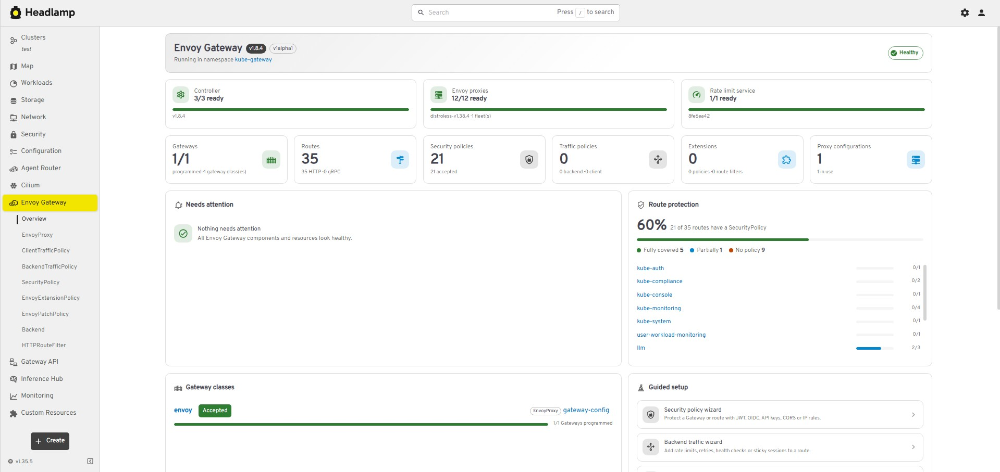
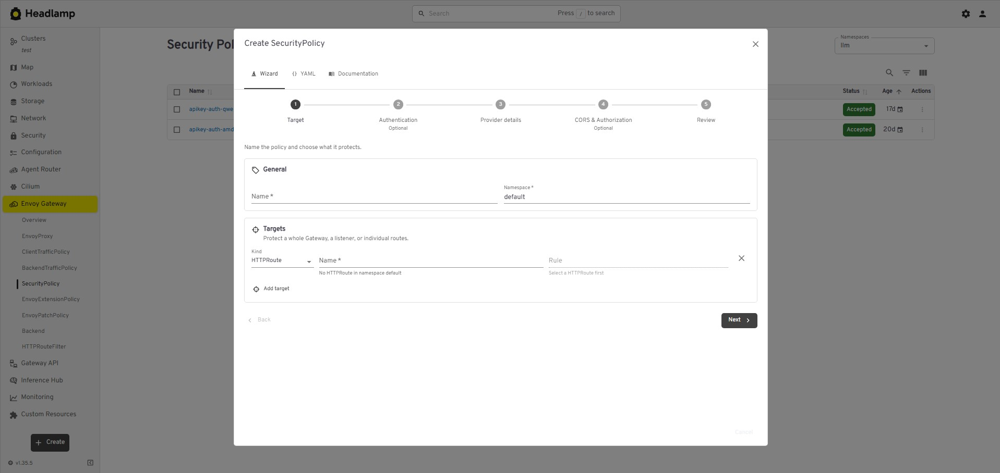

# Envoy Gateway — Headlamp plugin

[English](#english) | [Türkçe](#türkçe)

---

## English

A [Headlamp](https://headlamp.dev) plugin for managing [Envoy Gateway](https://gateway.envoyproxy.io)
resources (`gateway.envoyproxy.io`). It adds an **Envoy Gateway** section to the sidebar with an
overview page and list, detail, form and wizard screens for every CRD.

Target versions: **Headlamp ≥ 0.45.0**, vanilla Kubernetes with Envoy Gateway v1.x.

### Features

| Area                   | What you get                                                                                                                                                                                                                                                                                                                                                                                                                                                                                                                                                                                                                                                                                                                            |
| ---------------------- | --------------------------------------------------------------------------------------------------------------------------------------------------------------------------------------------------------------------------------------------------------------------------------------------------------------------------------------------------------------------------------------------------------------------------------------------------------------------------------------------------------------------------------------------------------------------------------------------------------------------------------------------------------------------------------------------------------------------------------------- |
| **Overview**           | Controller version and readiness, the GatewayClasses managed by Envoy Gateway, health cards per CRD and a "Needs attention" table                                                                                                                                                                                                                                                                                                                                                                                                                                                                                                                                                                                                       |
| **Supported CRDs**     | EnvoyProxy, ClientTrafficPolicy, BackendTrafficPolicy, SecurityPolicy, EnvoyExtensionPolicy, EnvoyPatchPolicy, Backend, HTTPRouteFilter                                                                                                                                                                                                                                                                                                                                                                                                                                                                                                                                                                                                 |
| **Relationships**      | Clickable targets (Gateway, HTTPRoute, GRPCRoute, Secret, Service, ConfigMap, …) and a "Used by" section for EnvoyProxy, Backend and HTTPRouteFilter                                                                                                                                                                                                                                                                                                                                                                                                                                                                                                                                                                                    |
| **Reverse references** | An "Envoy Gateway" section on Headlamp's Gateway, GatewayClass, HTTPRoute and GRPCRoute pages listing the policies attached to them (or inherited from the Gateway)                                                                                                                                                                                                                                                                                                                                                                                                                                                                                                                                                                     |
| **Resource map**       | Policy → target, Gateway/GatewayClass → EnvoyProxy and Route → Backend/HTTPRouteFilter edges                                                                                                                                                                                                                                                                                                                                                                                                                                                                                                                                                                                                                                            |
| **Create / edit**      | Form, YAML and Documentation tabs in one dialog for every CRD; form and YAML stay in sync in both directions; client-side validation                                                                                                                                                                                                                                                                                                                                                                                                                                                                                                                                                                                                    |
| **Wizards**            | SecurityPolicy (target → authentication method → provider details → CORS and authorization → summary) and BackendTrafficPolicy (target → scenarios → settings → summary)                                                                                                                                                                                                                                                                                                                                                                                                                                                                                                                                                                |
| **Credential Secrets** | The API key, basic auth and OIDC methods of SecurityPolicy either use an existing Secret, which is never changed, or create a new one from the values entered in the form (client IDs and keys, users and passwords, the client secret). A new Secret is owned by the policy (owner reference) and deleted together with it; applying stops with an error if a Secret with that name already exists. When editing, a Secret that belongs to the policy can be updated: stored values are never shown again and a field left empty keeps its value. A Secret of the policy that is no longer used (its method switched off, or another Secret chosen) is deleted when the policy is saved. Basic auth passwords are stored as SHA hashes |
| **Status**             | Combined status across all ancestors ("Accepted 1/2") and condition tables                                                                                                                                                                                                                                                                                                                                                                                                                                                                                                                                                                                                                                                              |
| **Robustness**         | API version discovery per cluster, CRDs that are not installed are hidden from the sidebar with explanatory empty pages, an error boundary around every route                                                                                                                                                                                                                                                                                                                                                                                                                                                                                                                                                                           |

The UI is English only.

### Screenshots

**Overview**



**SecurityPolicy wizard**



### Requirements

- Headlamp **0.45.0** or newer.
- Envoy Gateway **v1.x** (`gateway.envoyproxy.io` CRDs) and the Gateway API CRDs.
- The plugin uses the permissions of the signed-in user. Creating or updating the credential
  Secrets of a SecurityPolicy also needs `get`, `list`, `create`, `update`, `patch` (linking the
  Secret to the policy) and `delete` (removing it again when the policy cannot be applied) on Secrets
  in the policy namespace.

### Installation

#### From the Headlamp plugin catalog (Artifact Hub)

The plugin is published on [Artifact Hub](https://artifacthub.io/packages/headlamp/batuhancikrikci-headlamp-plugins/envoy-gateway). In the Headlamp desktop app, open the plugin
catalog, search for **Envoy Gateway** and install it. The catalog shows only official plugins by default; turn off the **Only Official** switch in the
catalog (or **Display only Official Plugins** in its settings) to see this plugin.

#### Manual installation

Download `envoy-gateway-<version>.tar.gz` from [GitHub Releases](https://github.com/batuhancikrikci/headlamp-plugins/releases), compare its SHA-256
checksum with the `.sha256` file and extract it into the Headlamp plugins directory:

| Platform | Plugins directory                                                                                       |
| -------- | ------------------------------------------------------------------------------------------------------- |
| Linux    | `~/.config/Headlamp/plugins/` (or `~/.local/share/Headlamp/plugins/` when it exists)                    |
| macOS    | `~/Library/Application Support/Headlamp/plugins/` (otherwise `~/Library/Preferences/Headlamp/plugins/`) |
| Windows  | `%APPDATA%\Headlamp\Config\plugins\` (or `%LOCALAPPDATA%\Headlamp\Data\plugins\` when it exists)        |

```bash
tar -xzf envoy-gateway-*.tar.gz -C ~/.config/Headlamp/plugins/
```

The directory must contain `envoy-gateway/main.js` and `envoy-gateway/package.json`. Reload Headlamp afterwards
(Ctrl+Shift+R / Cmd+Shift+R).

To confirm that the tarball was built from this repository by its release workflow, verify its
build provenance with the [GitHub CLI](https://cli.github.com):
`gh attestation verify envoy-gateway-<version>.tar.gz --repo batuhancikrikci/headlamp-plugins`.

#### From source

```bash
npm ci
npm run deploy        # icons, type-check, lint, tests, build, install
```

`npm run deploy` installs the plugin into the plugins directory of the Headlamp desktop app, found
the same way `headlamp-plugin start` finds it. Set `HEADLAMP_PLUGINS_DIR` to install somewhere
else, and use `npm run deploy:fast` to skip the checks. The previous version is replaced atomically,
and the script warns about other copies of the plugin that Headlamp might load instead.

#### In-cluster Headlamp

The plugin manager of the Headlamp Helm chart can install the plugin from Artifact Hub:

```yaml
pluginsManager:
  enabled: true
  configContent: |
    plugins:
      - name: envoy-gateway
        source: https://artifacthub.io/packages/headlamp/batuhancikrikci-headlamp-plugins/envoy-gateway
```

Without a `version` field the latest release is installed; add `version: <x.y.z>` under `source`
to pin one.

Alternatively, extract the tarball built by `npm run package` into the directory passed to the
Headlamp server with `-plugins-dir` (`/headlamp/plugins` in the official image), from an init
container or with a custom image:

```dockerfile
FROM node:20-alpine AS build
WORKDIR /plugin
COPY package.json package-lock.json ./
RUN npm ci
COPY . .
RUN npm run build && cp package.json dist/

FROM ghcr.io/headlamp-k8s/headlamp:v0.45.0
COPY --from=build /plugin/dist /headlamp/plugins/envoy-gateway
```

### Configuration

The plugin has no settings of its own; it works with the permissions of the Kubernetes user.

### Compatibility

| Component     | Version                                    |
| ------------- | ------------------------------------------ |
| Headlamp      | ≥ 0.45.0 (`@kinvolk/headlamp-plugin` 0.14) |
| Envoy Gateway | v1.x                                       |

API versions are discovered at runtime; the table lists the versions used during development and testing.

### Notes and limitations

- `EnvoyPatchPolicy` has no effect unless `extensionApis.enableEnvoyPatchPolicy` is enabled in the
  Envoy Gateway configuration, even when the CRD is installed; the form shows this as a warning.
- Client-side validation catches common mistakes early. The API server (CRD schema and CEL rules)
  remains the final check, and its errors are shown in the dialog.
- Fields without a form control (for example Lua extensions or JWT claim based authorization) are
  edited in the YAML tab and are preserved when the object is edited with the form.

### Development

Requires Node.js **20.11+** and npm **10+**. In the plugin directory:

```bash
npm ci
npm start             # rebuilds on every change and copies the result into the local Headlamp
```

| Command                             | What it does                                              |
| ----------------------------------- | --------------------------------------------------------- |
| `npm start`                         | Watch mode; every build is copied into the local Headlamp |
| `npm run build`                     | Production bundle in `dist/`                              |
| `npm run check`                     | Type-check, lint and unit tests                           |
| `npm run tsc`                       | Type-check (strict)                                       |
| `npm run lint` / `npm run lint-fix` | ESLint, zero warnings allowed                             |
| `npm run format`                    | Prettier                                                  |
| `npm test`                          | Vitest unit tests                                         |
| `npm run storybook`                 | Component stories                                         |
| `npm run package`                   | `envoy-gateway-<version>.tar.gz` for distribution         |
| `npm run deploy` / `deploy:fast`    | Build and install into the local Headlamp desktop app     |

Icons are bundled, so the plugin works without internet access: `npm run icons` collects every
`mdi:` and `simple-icons:` id used in `src/` into `src/icons/bundle.json` (`start`, `build`,
`package` and `storybook` run it first).

`src/common/` holds the building blocks shared by every plugin of this repository (states, error
boundary, CRD documentation, form fields, editor and wizards). The copies are identical in every
plugin; `src/plugin.ts` describes this plugin to them.

#### Project layout

```text
src/
  index.tsx                 Sidebar, routes, details section, map and kind icon registrations
  plugin.ts                 Identity of the plugin, used by src/common
  common/                   Shared building blocks, identical in every plugin of this repository
  icons/                    Sidebar icon, generated icon bundle
  resources/                CRD classes (base.ts), types and the CRD registry (registry.ts)
  utils/                    Pure, unit-tested helpers without Headlamp imports
    versionDiscovery.tsx    API version / CRD discovery per cluster
    conditions.ts           Status summaries
    targets.ts              Policy ↔ target matching, route references
    validation.ts           Form validation
    templates.ts            Creation templates and BackendTrafficPolicy scenarios
  components/
    common/                 Shared views, CRD gate, reference links
    common/form/            Target picker, reference fields, create / edit actions
    overview/               Overview page
    relations/              "Used by", reverse reference section, resource map source
    <crd>/                  List, Detail, Form (and Wizard where needed) per CRD
scripts/
  build-icons.mjs           Offline icon bundle (src/icons/bundle.json)
  deploy.mjs                Build and install into the local Headlamp desktop app
```

### License

Licensed under the [Apache License 2.0](LICENSE). Third-party components and trademark notices are listed in [NOTICE](NOTICE).

This is an independent project; it is not affiliated with or endorsed by the Headlamp project or the projects it works with. Kubernetes, Headlamp, Envoy and Envoy Gateway are trademarks of their respective owners and are used only to identify the software this plugin works with. The package logo is based on the Envoy logo and is used for the same purpose only.

### Contributing

Open an [issue](https://github.com/batuhancikrikci/headlamp-plugins/issues) for bugs and ideas. The contribution guidelines are in [CONTRIBUTING.md](../CONTRIBUTING.md) and security reports are handled as described in [SECURITY.md](../SECURITY.md).

---

## Türkçe

[Envoy Gateway](https://gateway.envoyproxy.io) kaynaklarını (`gateway.envoyproxy.io`) yönetmek için
bir [Headlamp](https://headlamp.dev) eklentisi. Kenar çubuğuna bir genel bakış sayfası ve her CRD için
liste, detay, form ve sihirbaz ekranları içeren bir **Envoy Gateway** bölümü ekler.

Hedef sürümler: **Headlamp ≥ 0.45.0**, Envoy Gateway v1.x kullanan vanilla Kubernetes.

### Özellikler

| Alan                           | Neler sunar                                                                                                                                                                                                                                                                                                                                                                                                                                                                                                                                                                                                                                                                                                                             |
| ------------------------------ | --------------------------------------------------------------------------------------------------------------------------------------------------------------------------------------------------------------------------------------------------------------------------------------------------------------------------------------------------------------------------------------------------------------------------------------------------------------------------------------------------------------------------------------------------------------------------------------------------------------------------------------------------------------------------------------------------------------------------------------- |
| **Genel bakış**                | Controller sürümü ve hazır olma durumu, Envoy Gateway'in yönettiği GatewayClass'lar, CRD başına sağlık kartları ve "dikkat gerektirenler" tablosu                                                                                                                                                                                                                                                                                                                                                                                                                                                                                                                                                                                       |
| **Desteklenen CRD'ler**        | EnvoyProxy, ClientTrafficPolicy, BackendTrafficPolicy, SecurityPolicy, EnvoyExtensionPolicy, EnvoyPatchPolicy, Backend, HTTPRouteFilter                                                                                                                                                                                                                                                                                                                                                                                                                                                                                                                                                                                                 |
| **İlişkiler**                  | Tıklanabilir hedefler (Gateway, HTTPRoute, GRPCRoute, Secret, Service, ConfigMap, …) ve EnvoyProxy, Backend ve HTTPRouteFilter için "kullananlar" bölümü                                                                                                                                                                                                                                                                                                                                                                                                                                                                                                                                                                                |
| **Ters referanslar**           | Headlamp'in Gateway, GatewayClass, HTTPRoute ve GRPCRoute sayfalarında, bunlara doğrudan bağlanan veya Gateway seviyesinden devralınan politikaları listeleyen bir "Envoy Gateway" bölümü                                                                                                                                                                                                                                                                                                                                                                                                                                                                                                                                                                 |
| **Resource map**               | Politika → hedef, Gateway/GatewayClass → EnvoyProxy ve Route → Backend/HTTPRouteFilter bağlantıları (edges)                                                                                                                                                                                                                                                                                                                                                                                                                                                                                                                                                                                                                                        |
| **Oluşturma / düzenleme**      | Her CRD için tek pencerede Form, YAML ve Documentation sekmeleri; form ve YAML iki yönlü senkron; istemci tarafı doğrulama                                                                                                                                                                                                                                                                                                                                                                                                                                                                                                                                                                                                              |
| **Sihirbazlar**                | SecurityPolicy (hedef → kimlik doğrulama yöntemi → sağlayıcı ayrıntıları → CORS ve yetkilendirme → özet) ve BackendTrafficPolicy (hedef → senaryolar → ayarlar → özet)                                                                                                                                                                                                                                                                                                                                                                                                                                                                                                                                                                  |
| **Kimlik bilgisi Secret'ları** | SecurityPolicy'nin API key, basic auth ve OIDC yöntemleri ya hiç değiştirilmeyen mevcut bir Secret'ı kullanır ya da formda girilen değerlerden (istemci kimlikleri ve anahtarlar, kullanıcılar ve parolalar, client secret) yeni bir Secret oluşturur. Yeni Secret politikaya bağlanır (owner reference) ve politikayla birlikte silinir; bu adda bir Secret zaten mevcutsa işlem hata vererek durdurulur. Düzenleme sırasında politikaya ait Secret güncellenebilir: daha önce girilmiş hassas değerler güvenlik gerekçesiyle tekrar gösterilmez, boş bırakılan alanlar mevcut değerini korur. Politikaya ait olup artık kullanılmayan bir Secret (yöntem kapatıldığında ya da başka bir Secret seçildiğinde) politika kaydedilince otomatik olarak silinir. Basic auth parolaları SHA özeti olarak saklanır |
| **Durum**                      | Tüm üst kaynakları (ancestors) kapsayan birleşik durum özeti ("Accepted 1/2") ve koşul tabloları                                                                                                                                                                                                                                                                                                                                                                                                                                                                                                                                                                                                                                                           |
| **Dayanıklılık**               | Küme başına API sürümü keşfi; kurulu olmayan CRD'ler açıklamalı boş sayfalarla kenar çubuğundan gizlenir; her rotanın etrafında hata yakalama                                                                                                                                                                                                                                                                                                                                                                                                                                                                                                                                                                                           |

Arayüz yalnızca İngilizcedir.

### Ekran görüntüleri

**Genel bakış**


**SecurityPolicy sihirbazı**


### Gereksinimler

- Headlamp **0.45.0** veya üstü.
- Envoy Gateway **v1.x** (`gateway.envoyproxy.io` CRD'leri) ve Gateway API CRD'leri.
- Eklenti oturum açmış kullanıcının yetkileriyle çalışır. Bir SecurityPolicy'nin kimlik bilgisi
  Secret'larını oluşturmak ya da güncellemek için politikanın namespace'inde Secret'lar üzerinde
  `get`, `list`, `create`, `update`, `patch` (Secret'ı politikaya bağlamak için) ve `delete` (işlem
  başarısız olursa oluşturulan geçici kaynakları geri almak için) yetkileri de gerekir.

### Kurulum

#### Headlamp eklenti kataloğundan (Artifact Hub)

Eklenti [Artifact Hub](https://artifacthub.io/packages/headlamp/batuhancikrikci-headlamp-plugins/envoy-gateway) üzerinde yayınlanır. Headlamp masaüstü uygulamasında eklenti
kataloğunu açın, **Envoy Gateway** araması yapın ve eklentiyi kurun. Katalog varsayılan olarak yalnızca resmî (official) eklentileri gösterir; bu eklentiyi görmek için
katalogdaki **Only Official** anahtarını (ya da ayarlarındaki **Display only Official Plugins** seçeneğini) kapatın.

#### Elle kurulum

[GitHub Releases](https://github.com/batuhancikrikci/headlamp-plugins/releases) sayfasından `envoy-gateway-<sürüm>.tar.gz` dosyasını indirin, SHA-256
sağlama toplamını (checksum) `.sha256` dosyasıyla doğrulayın ve Headlamp eklenti dizinine açın:

| Platform | Eklenti dizini                                                                                      |
| -------- | --------------------------------------------------------------------------------------------------- |
| Linux    | `~/.config/Headlamp/plugins/` (varsa `~/.local/share/Headlamp/plugins/`)                            |
| macOS    | `~/Library/Application Support/Headlamp/plugins/` (yoksa `~/Library/Preferences/Headlamp/plugins/`) |
| Windows  | `%APPDATA%\Headlamp\Config\plugins\` (varsa `%LOCALAPPDATA%\Headlamp\Data\plugins\`)                |

```bash
tar -xzf envoy-gateway-*.tar.gz -C ~/.config/Headlamp/plugins/
```

Dizinde `envoy-gateway/main.js` ve `envoy-gateway/package.json` bulunmalıdır. Ardından Headlamp'i yeniden
yükleyin (Ctrl+Shift+R / Cmd+Shift+R).

Paketin bu depodaki sürüm iş akışıyla derlendiğini, derleme kaynağı kanıtını
[GitHub CLI](https://cli.github.com) ile denetleyerek doğrulayabilirsiniz:
`gh attestation verify envoy-gateway-<sürüm>.tar.gz --repo batuhancikrikci/headlamp-plugins`.

#### Kaynaktan kurulum

```bash
npm ci
npm run deploy        # ikonlar, tip denetimi, lint, testler, derleme, kurulum
```

`npm run deploy` eklentiyi Headlamp masaüstü uygulamasının eklenti dizinine, `headlamp-plugin start`
ile aynı kuralla bulduğu dizine kurar. Başka bir dizin için `HEADLAMP_PLUGINS_DIR` ayarlayın;
denetimleri atlamak için `npm run deploy:fast` kullanın. Önceki sürüm atomik olarak değiştirilir ve
betik, Headlamp'in onun yerine yükleyebileceği başka kopyalar hakkında uyarır.

#### Küme içi Headlamp

Headlamp Helm chart'ının eklenti yöneticisiyle eklenti Artifact Hub'dan kurulabilir:

```yaml
pluginsManager:
  enabled: true
  configContent: |
    plugins:
      - name: envoy-gateway
        source: https://artifacthub.io/packages/headlamp/batuhancikrikci-headlamp-plugins/envoy-gateway
```

`version` alanı yazılmazsa en son sürüm kurulur; bir sürümü sabitlemek için `source` altına
`version: <x.y.z>` ekleyin.

Ya da `npm run package` ile üretilen tarball'ı Headlamp sunucusuna `-plugins-dir` ile verilen dizine
(resmî imajda `/headlamp/plugins`) bir init container ile veya özel bir imajla açın:

```dockerfile
FROM node:20-alpine AS build
WORKDIR /plugin
COPY package.json package-lock.json ./
RUN npm ci
COPY . .
RUN npm run build && cp package.json dist/

FROM ghcr.io/headlamp-k8s/headlamp:v0.45.0
COPY --from=build /plugin/dist /headlamp/plugins/envoy-gateway
```

### Yapılandırma

Eklentinin ayrı bir yapılandırması yoktur; Kubernetes kullanıcısının yetkileriyle çalışır.

### Uyumluluk

| Bileşen       | Sürüm                                      |
| ------------- | ------------------------------------------ |
| Headlamp      | ≥ 0.45.0 (`@kinvolk/headlamp-plugin` 0.14) |
| Envoy Gateway | v1.x                                       |

API sürümleri çalışma zamanında keşfedilir; tabloda geliştirme ve test sırasında kullanılan sürümler yer alır.

### Notlar ve sınırlamalar

- `EnvoyPatchPolicy`, CRD kurulu olsa bile Envoy Gateway yapılandırmasında
  `extensionApis.enableEnvoyPatchPolicy` açık değilse etkili olmaz; form bunu uyarı olarak gösterir.
- İstemci tarafı doğrulama yaygın hataları erkenden yakalar. Son denetimi API sunucusu (CRD şeması
  ve CEL kuralları) yapar ve hataları pencerede gösterilir.
- Form karşılığı olmayan alanlar (örneğin Lua eklentileri veya JWT claim tabanlı yetkilendirme) YAML
  sekmesinde düzenlenir ve nesne formla düzenlendiğinde korunur.

### Geliştirme

Node.js **20.11+** ve npm **10+** gerekir. Eklenti dizininde:

```bash
npm ci
npm start             # her değişiklikte derler ve sonucu yerel Headlamp'e kopyalar
```

| Komut                               | Ne yapar                                             |
| ----------------------------------- | ---------------------------------------------------- |
| `npm start`                         | İzleme modu; her derleme yerel Headlamp'e kopyalanır |
| `npm run build`                     | `dist/` altında üretim paketi                        |
| `npm run check`                     | Tip denetimi, lint ve birim testleri                 |
| `npm run tsc`                       | Tip denetimi (strict)                                |
| `npm run lint` / `npm run lint-fix` | ESLint, sıfır uyarı                                  |
| `npm run format`                    | Prettier                                             |
| `npm test`                          | Vitest birim testleri                                |
| `npm run storybook`                 | Bileşen hikâyeleri                                   |
| `npm run package`                   | Dağıtım için `envoy-gateway-<sürüm>.tar.gz`          |
| `npm run deploy` / `deploy:fast`    | Derleyip yerel Headlamp masaüstüne kurar             |

İkonlar pakete gömülüdür, eklenti internet erişimi olmadan çalışır: `npm run icons`, `src/` içinde
kullanılan her `mdi:` ve `simple-icons:` kimliğini `src/icons/bundle.json` dosyasına toplar
(`start`, `build`, `package` ve `storybook` komutları öncelikli olarak bu adımı çalıştırır).

`src/common/` bu depodaki tüm eklentilerde ortak olan yapı taşlarını içerir (durum ekranları, hata
yakalama, CRD dokümantasyonu, form alanları, editör ve sihirbazlar). Kopyalar her eklentide tamamen
aynıdır; `src/plugin.ts` bu eklentiyi onlara tanıtır.

#### Dosya yapısı

```text
src/
  index.tsx                 Kenar çubuğu, rota, detay bölümü, harita ve tür ikonu kayıtları
  plugin.ts                 Eklentinin kimliği (src/common tarafından kullanılır)
  common/                   Ortak yapı taşları, bu depodaki tüm eklentilerde tamamen aynı
  icons/                    Kenar çubuğu ikonu, üretilen ikon paketi
  resources/                CRD sınıfları (base.ts), tipler ve CRD kayıt defteri (registry.ts)
  utils/                    Headlamp importu olmayan, birim testli yardımcılar
    versionDiscovery.tsx    Küme başına API sürümü / CRD keşfi
    conditions.ts           Durum özetleri
    targets.ts              Politika ↔ hedef eşleştirme, route referansları
    validation.ts           Form doğrulaması
    templates.ts            Oluşturma şablonları ve BackendTrafficPolicy senaryoları
  components/
    common/                 Ortak görünümler, CRD kapısı, referans bağlantıları
    common/form/            Hedef seçici, referans alanları, oluşturma / düzenleme eylemleri
    overview/               Genel bakış sayfası
    relations/              "Kullananlar", ters referans bölümü, Resource Map kaynağı
    <crd>/                  CRD başına List, Detail, Form (gerekiyorsa Wizard)
scripts/
  build-icons.mjs           Çevrimdışı ikon paketi (src/icons/bundle.json)
  deploy.mjs                Derler ve yerel Headlamp masaüstüne kurar
```

### Lisans

[Apache License 2.0](LICENSE) ile lisanslanmıştır. Üçüncü taraf bileşenler ve marka bildirimleri [NOTICE](NOTICE) dosyasındadır.

Bu bağımsız bir projedir; Headlamp projesiyle ya da birlikte çalıştığı projelerle bağlantılı değildir ve onlar tarafından onaylanmamıştır. Kubernetes, Headlamp, Envoy ve Envoy Gateway ilgili sahiplerinin ticari markalarıdır; yalnızca eklentinin birlikte çalıştığı yazılımı tanımlamak için kullanılır. Paket logosu, Envoy logosundan esinlenmiştir ve yalnızca aynı amaçla kullanılır.

### Katkıda bulunma

Hata bildirimleri ve öneriler için [issue](https://github.com/batuhancikrikci/headlamp-plugins/issues) açın. Katkı kuralları [CONTRIBUTING.md](../CONTRIBUTING.md), güvenlik bildirimleri [SECURITY.md](../SECURITY.md) içindedir.
