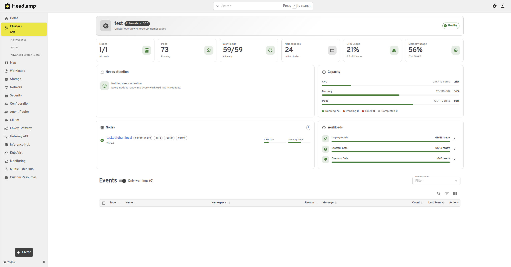
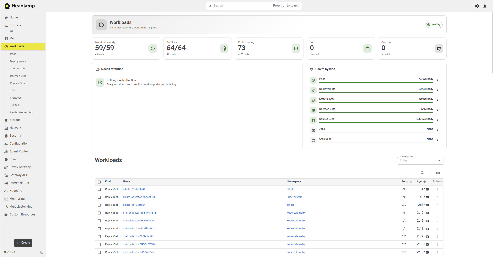

# Headlamp Plus — Headlamp plugin

[English](#english) | [Türkçe](#türkçe)

---

## English

An out-of-tree [Headlamp](https://headlamp.dev) plugin that keeps Headlamp's original look while
adding a few refinements and restrictions. It does not modify Headlamp itself and works the same
in the web (in-cluster) and desktop (Electron) versions.

Target: **Headlamp 0.45.0**, `@kinvolk/headlamp-plugin` **0.14.x**.

### Features

| Feature                               | How                                                                                                                                                                                     |
| ------------------------------------- | --------------------------------------------------------------------------------------------------------------------------------------------------------------------------------------- |
| **Headlamp Plus Light / Dark** themes | Headlamp's stock light and dark palettes, registered with `registerAppTheme` (`src/themes.ts`)                                                                                          |
| Only these two themes                 | Other theme cards are hidden in Settings; any other active theme is switched back through Headlamp's store. On first run the theme follows the OS colour scheme (`src/themeLock.tsx`)   |
| English-only UI                       | The language is pinned to English (query string, cookie and stored preference) and the language selector is hidden (`src/language.ts`)                                                  |
| Cluster overview                      | A card-based dashboard replaces the cluster home: health, what needs attention, capacity and usage, nodes and workloads. Headlamp's events table is kept (`src/overview/`)              |
| Workloads overview                    | The same dashboard layout for the Workloads page; Headlamp's workloads table is kept and the dashboard follows its namespace filter                                                     |
| Same-tab OIDC sign-in (web only)      | "Sign In" goes to the identity provider in the same tab instead of a popup and returns to the page the user wanted (`src/oidcRedirect.ts`)                                              |
| Style refinements                     | Neutral scrollbars, selection colour and keyboard focus ring from the active theme, native controls following light/dark, "Custom Resources" kept last in the sidebar (`src/styles.ts`) |

The plugin can be disabled or removed from Settings > Plugins like any other plugin; Headlamp then
returns to its stock themes and language selector.

### Screenshots

**Cluster overview**



**Workloads overview**



### Requirements

- Headlamp **0.45.0** (`@kinvolk/headlamp-plugin` 0.14). The selectors rely on this version's DOM structure; check them after upgrading Headlamp.
- Do not install it together with another plugin that registers themes; two theme locks would fight over the active theme.

### Installation

#### From the Headlamp plugin catalog (Artifact Hub)

The plugin is published on [Artifact Hub](https://artifacthub.io/packages/headlamp/batuhancikrikci-headlamp-plugins/headlamp-plus). In the Headlamp desktop app, open the plugin
catalog, search for **Headlamp Plus** and install it. The catalog shows only official plugins by default; turn off the **Only Official** switch in the
catalog (or **Display only Official Plugins** in its settings) to see this plugin.

#### Manual installation

Download `headlamp-plus-<version>.tar.gz` from [GitHub Releases](https://github.com/batuhancikrikci/headlamp-plugins/releases), compare its SHA-256
checksum with the `.sha256` file and extract it into the Headlamp plugins directory:

| Platform | Plugins directory                                                                                       |
| -------- | ------------------------------------------------------------------------------------------------------- |
| Linux    | `~/.config/Headlamp/plugins/` (or `~/.local/share/Headlamp/plugins/` when it exists)                    |
| macOS    | `~/Library/Application Support/Headlamp/plugins/` (otherwise `~/Library/Preferences/Headlamp/plugins/`) |
| Windows  | `%APPDATA%\Headlamp\Config\plugins\` (or `%LOCALAPPDATA%\Headlamp\Data\plugins\` when it exists)        |

```bash
tar -xzf headlamp-plus-*.tar.gz -C ~/.config/Headlamp/plugins/
```

The directory must contain `headlamp-plus/main.js` and `headlamp-plus/package.json`. Reload Headlamp afterwards
(Ctrl+Shift+R / Cmd+Shift+R).

To confirm that the tarball was built from this repository by its release workflow, verify its
build provenance with the [GitHub CLI](https://cli.github.com):
`gh attestation verify headlamp-plus-<version>.tar.gz --repo batuhancikrikci/headlamp-plugins`.

#### From source

```bash
npm ci
npm run deploy        # icons, type-check, lint, tests, build, install
```

`npm run deploy` installs the plugin into the plugins directory of the Headlamp desktop app, found
the same way `headlamp-plugin start` finds it. Set `HEADLAMP_PLUGINS_DIR` to install somewhere
else, and use `npm run deploy:fast` to skip the checks. The previous version is replaced atomically,
and the script warns about other copies of the plugin that Headlamp might load instead.

Because Headlamp Plus registers themes, `npm run deploy` also warns about other installed plugins that register themes (two theme locks would fight over the active theme); `npm run deploy -- --strict` fails instead.

#### In-cluster Headlamp

The plugin manager of the Headlamp Helm chart can install the plugin from Artifact Hub:

```yaml
pluginsManager:
  enabled: true
  configContent: |
    plugins:
      - name: headlamp-plus
        source: https://artifacthub.io/packages/headlamp/batuhancikrikci-headlamp-plugins/headlamp-plus
```

Without a `version` field the latest release is installed; add `version: <x.y.z>` under `source`
to pin one.

Alternatively, extract the tarball built by `npm run package` into the directory passed to the
Headlamp server with `-plugins-dir` (`/headlamp/plugins` in the official image), from an init
container or with a custom image:

```dockerfile
FROM node:20-alpine AS build
WORKDIR /plugin
COPY package.json package-lock.json ./
RUN npm ci
COPY . .
RUN npm run build && cp package.json dist/

FROM ghcr.io/headlamp-k8s/headlamp:v0.45.0
COPY --from=build /plugin/dist /headlamp/plugins/headlamp-plus
```

### Configuration

The product name and theme names come from `PRODUCT_NAME` in `src/config.ts`. Rebuild the plugin after changing it.

### Compatibility

| Component              | Version                                   |
| ---------------------- | ----------------------------------------- |
| Headlamp               | 0.45.0 (`@kinvolk/headlamp-plugin` 0.14)  |
| Browser (CSS `:has()`) | Chromium 105+, Firefox 121+, Safari 15.4+ |

API versions are discovered at runtime; the table lists the versions used during development and testing.

### Notes and limitations

- **Electron main process:** the window title, application menu, tray and window icon are created
  by Electron's main process; plugins cannot change them.
- **Language lock:** Headlamp's i18next instance is not exposed to plugins, so the language is
  pinned where its detector reads it and the page reloads once when needed.
- **First start:** before plugins load, Headlamp may briefly paint its own theme. The theme choice is
  stored, so later starts open with the Headlamp Plus theme directly.
- **Selectors:** the language selector, theme cards and sidebar ordering rely on Headlamp 0.45 /
  plugin lib 0.14 DOM structure and CSS `:has()` (Chromium 105+, Firefox 121+, Safari 15.4+); check
  them after upgrading Headlamp.
- **OIDC redirect:** relies on Headlamp opening the login popup with `window.open` and returning to
  `/auth?cluster=…`; test it in-cluster after upgrading Headlamp.
- **Dashboards:** registered on Headlamp's `/` and `/workloads` routes so they replace the stock
  pages (plugin routes match first). Charts added with `registerOverviewChartsProcessor` are not shown.

### Development

Requires Node.js **20.11+** and npm **10+**. In the plugin directory:

```bash
npm ci
npm start             # rebuilds on every change and copies the result into the local Headlamp
```

| Command                             | What it does                                              |
| ----------------------------------- | --------------------------------------------------------- |
| `npm start`                         | Watch mode; every build is copied into the local Headlamp |
| `npm run build`                     | Production bundle in `dist/`                              |
| `npm run check`                     | Type-check, lint and unit tests                           |
| `npm run tsc`                       | Type-check (strict)                                       |
| `npm run lint` / `npm run lint-fix` | ESLint, zero warnings allowed                             |
| `npm run format`                    | Prettier                                                  |
| `npm test`                          | Vitest unit tests                                         |
| `npm run storybook`                 | Component stories                                         |
| `npm run package`                   | `headlamp-plus-<version>.tar.gz` for distribution         |
| `npm run deploy` / `deploy:fast`    | Build and install into the local Headlamp desktop app     |

Icons are bundled, so the plugin works without internet access: `npm run icons` collects every
`mdi:` and `simple-icons:` id used in `src/` into `src/icons/bundle.json` (`start`, `build`,
`package` and `storybook` run it first).

`src/common/` holds the building blocks shared by every plugin of this repository (states, error
boundary, CRD documentation, form fields, editor and wizards). The copies are identical in every
plugin; `src/plugin.ts` describes this plugin to them.

#### Project layout

```text
src/
  index.tsx                 Registrations and start-up
  plugin.ts                 Identity of the plugin, used by src/common
  common/                   Shared building blocks, identical in every plugin of this repository
  icons/                    Generated icon bundle
  config.ts                 Product name, theme names, locked language
  themes.ts                 Headlamp Plus Light / Dark (Headlamp's stock palettes)
  themeLock.tsx             Theme lock: store guard, hidden theme cards, first-run theme
  language.ts               English-only language lock
  styles.ts                 Global CSS refinements and hiding rules
  oidcRedirect.ts           Web: OIDC sign-in in the same tab
  overview/                 Cluster and Workloads dashboards
scripts/
  build-icons.mjs           Offline icon bundle (src/icons/bundle.json)
  deploy.mjs                Build and install into the local Headlamp desktop app
```

### License

Licensed under the [Apache License 2.0](LICENSE). Third-party components and trademark notices are listed in [NOTICE](NOTICE).

This is an independent project; it is not affiliated with or endorsed by the Headlamp project or the projects it works with. Kubernetes and Headlamp are trademarks of their respective owners and are used only to identify the software this plugin works with. The package logo is based on the Headlamp logo and is used for the same purpose only.

### Contributing

Open an [issue](https://github.com/batuhancikrikci/headlamp-plugins/issues) for bugs and ideas. The contribution guidelines are in [CONTRIBUTING.md](../CONTRIBUTING.md) and security reports are handled as described in [SECURITY.md](../SECURITY.md).

---

## Türkçe

Headlamp'in orijinal görünümünü korurken harici (out-of-tree) iyileştirmeler ve yapılandırma kuralları ekleyen
bir [Headlamp](https://headlamp.dev) eklentisi. Headlamp çekirdek kodunu değiştirmeden
web (küme içi) ve masaüstü (Electron) sürümlerinde sorunsuz çalışır.

Hedef: **Headlamp 0.45.0**, `@kinvolk/headlamp-plugin` **0.14.x**.

### Özellikler

| Özellik                                 | Nasıl                                                                                                                                                                                              |
| --------------------------------------- | -------------------------------------------------------------------------------------------------------------------------------------------------------------------------------------------------- |
| **Headlamp Plus Light / Dark** temaları | `registerAppTheme` ile kaydedilen, Headlamp'in standart açık ve koyu paletleri (`src/themes.ts`)                                                                                                   |
| Yalnızca bu iki tema                    | Ayarlar'daki diğer tema kartları gizlenir; başka bir tema aktif olursa Headlamp'in store'u üzerinden geri çevrilir. İlk açılışta tema işletim sisteminin renk şemasını izler (`src/themeLock.tsx`) |
| Yalnızca İngilizce arayüz               | Dil İngilizceye sabitlenir (sorgu dizesi, çerez ve kayıtlı tercih) ve dil seçici gizlenir (`src/language.ts`)                                                                                      |
| Küme genel bakışı                       | Küme ana sayfasının yerine kartlardan oluşan bir pano: sağlık, dikkat gerektirenler, kapasite ve kullanım, node'lar ve iş yükleri. Headlamp'in olay tablosu korunur (`src/overview/`)              |
| İş yükleri genel bakışı                 | Workloads sayfası için aynı pano düzeni; Headlamp'in iş yükü tablosu korunur ve pano onun namespace filtresini izler                                                                               |
| Aynı sekmede OIDC girişi (yalnızca web) | Giriş ("Sign In") işlemi kullanıcıyı açılır pencere yerine doğrudan aynı sekmede kimlik sağlayıcıya yönlendirir ve doğrulama tamamlandığında istenen sayfaya geri aktarır (`src/oidcRedirect.ts`)                                                             |
| Stil iyileştirmeleri                    | Aktif temadan nötr kaydırma çubukları, seçim rengi ve klavye odak halkası; açık/koyu temayı izleyen yerel kontroller; kenar çubuğunda en sonda tutulan "Custom Resources" (`src/styles.ts`)        |

Eklenti diğer eklentiler gibi Settings > Plugins üzerinden kapatılabilir veya kaldırılabilir; Headlamp
bu durumda standart temalarına ve dil seçicisine döner.

### Ekran görüntüleri

**Küme genel bakışı**


**İş yükleri genel bakışı**


### Gereksinimler

- Headlamp **0.45.0** (`@kinvolk/headlamp-plugin` 0.14). Seçiciler bu sürümün DOM yapısına dayanır; Headlamp sürüm yükseltmelerinden sonra kontrol edilmelidir.
- Tema kaydeden başka bir eklentiyle birlikte kurmayın; iki tema kilidi aktif tema için çakışır.

### Kurulum

#### Headlamp eklenti kataloğundan (Artifact Hub)

Eklenti [Artifact Hub](https://artifacthub.io/packages/headlamp/batuhancikrikci-headlamp-plugins/headlamp-plus) üzerinde yayınlanır. Headlamp masaüstü uygulamasında eklenti
kataloğunu açın, **Headlamp Plus** araması yapın ve eklentiyi kurun. Katalog varsayılan olarak yalnızca resmî (official) eklentileri gösterir; bu eklentiyi görmek için
katalogdaki **Only Official** anahtarını (ya da ayarlarındaki **Display only Official Plugins** seçeneğini) kapatın.

#### Elle kurulum

[GitHub Releases](https://github.com/batuhancikrikci/headlamp-plugins/releases) sayfasından `headlamp-plus-<sürüm>.tar.gz` dosyasını indirin, SHA-256
sağlama toplamını (checksum) `.sha256` dosyasıyla doğrulayın ve Headlamp eklenti dizinine açın:

| Platform | Eklenti dizini                                                                                      |
| -------- | --------------------------------------------------------------------------------------------------- |
| Linux    | `~/.config/Headlamp/plugins/` (varsa `~/.local/share/Headlamp/plugins/`)                            |
| macOS    | `~/Library/Application Support/Headlamp/plugins/` (yoksa `~/Library/Preferences/Headlamp/plugins/`) |
| Windows  | `%APPDATA%\Headlamp\Config\plugins\` (varsa `%LOCALAPPDATA%\Headlamp\Data\plugins\`)                |

```bash
tar -xzf headlamp-plus-*.tar.gz -C ~/.config/Headlamp/plugins/
```

Dizinde `headlamp-plus/main.js` ve `headlamp-plus/package.json` bulunmalıdır. Ardından Headlamp'i yeniden
yükleyin (Ctrl+Shift+R / Cmd+Shift+R).

Paketin bu depodaki sürüm iş akışıyla derlendiğini, derleme kaynağı kanıtını
[GitHub CLI](https://cli.github.com) ile denetleyerek doğrulayabilirsiniz:
`gh attestation verify headlamp-plus-<sürüm>.tar.gz --repo batuhancikrikci/headlamp-plugins`.

#### Kaynaktan kurulum

```bash
npm ci
npm run deploy        # ikonlar, tip denetimi, lint, testler, derleme, kurulum
```

`npm run deploy` eklentiyi Headlamp masaüstü uygulamasının eklenti dizinine, `headlamp-plugin start`
ile aynı kuralla bulduğu dizine kurar. Başka bir dizin için `HEADLAMP_PLUGINS_DIR` ayarlayın;
denetimleri atlamak için `npm run deploy:fast` kullanın. Önceki sürüm atomik olarak değiştirilir ve
betik, Headlamp'in onun yerine yükleyebileceği başka kopyalar hakkında uyarır.

Headlamp Plus tema kaydettiği için `npm run deploy`, tema kaydeden diğer kurulu eklentiler hakkında da uyarır (iki tema kilidi aktif tema için çakışır); `npm run deploy -- --strict` bu durumda hata verir.

#### Küme içi Headlamp

Headlamp Helm chart'ının eklenti yöneticisiyle eklenti Artifact Hub'dan kurulabilir:

```yaml
pluginsManager:
  enabled: true
  configContent: |
    plugins:
      - name: headlamp-plus
        source: https://artifacthub.io/packages/headlamp/batuhancikrikci-headlamp-plugins/headlamp-plus
```

`version` alanı yazılmazsa en son sürüm kurulur; bir sürümü sabitlemek için `source` altına
`version: <x.y.z>` ekleyin.

Ya da `npm run package` ile üretilen tarball'ı Headlamp sunucusuna `-plugins-dir` ile verilen dizine
(resmî imajda `/headlamp/plugins`) bir init container ile veya özel bir imajla açın:

```dockerfile
FROM node:20-alpine AS build
WORKDIR /plugin
COPY package.json package-lock.json ./
RUN npm ci
COPY . .
RUN npm run build && cp package.json dist/

FROM ghcr.io/headlamp-k8s/headlamp:v0.45.0
COPY --from=build /plugin/dist /headlamp/plugins/headlamp-plus
```

### Yapılandırma

Ürün adı ve tema adları `src/config.ts` dosyasındaki `PRODUCT_NAME` sabitinden gelir. Değiştirdikten sonra eklentiyi yeniden derleyin.

### Uyumluluk

| Bileşen                | Sürüm                                     |
| ---------------------- | ----------------------------------------- |
| Headlamp               | 0.45.0 (`@kinvolk/headlamp-plugin` 0.14)  |
| Browser (CSS `:has()`) | Chromium 105+, Firefox 121+, Safari 15.4+ |

API sürümleri çalışma zamanında keşfedilir; tabloda geliştirme ve test sırasında kullanılan sürümler yer alır.

### Notlar ve sınırlamalar

- **Electron ana süreci:** pencere başlığı, uygulama menüsü, tepsi ve pencere ikonu Electron'un ana
  sürecinde oluşturulur; eklentiler bunları değiştiremez.
- **Dil kilidi:** Headlamp'in i18next örneği eklentilere açık değildir; bu yüzden dil, dil
  algılayıcısının okuduğu yerlerde sabitlenir ve gerektiğinde sayfa bir kez yeniden yüklenir.
- **İlk açılış:** eklentiler yüklenmeden önce Headlamp kısa bir süre kendi temasını çizebilir. Tema
  seçimi saklandığı için sonraki açılışlar doğrudan Headlamp Plus temasıyla başlar.
- **Seçiciler:** dil seçici, tema kartları ve kenar çubuğu sıralaması Headlamp 0.45 / plugin lib 0.14
  DOM yapısına ve CSS `:has()` desteğine (Chromium 105+, Firefox 121+, Safari 15.4+) dayanır;
  Headlamp sürüm yükseltmelerinden sonra kontrol edilmelidir.
- **OIDC yönlendirmesi:** Headlamp'in giriş penceresini `window.open` ile açmasına ve
  `/auth?cluster=…` adresine dönmesi varsayımına dayanır; Headlamp sürümü yükseltildiğinde küme içinde test edilmelidir.
- **Panolar:** stok sayfaların yerine geçmeleri için Headlamp'in `/` ve `/workloads` rotalarına
  kaydedilir (eklenti rotaları önce eşleşir). `registerOverviewChartsProcessor` ile eklenen grafikler
  gösterilmez.

### Geliştirme

Node.js **20.11+** ve npm **10+** gerekir. Eklenti dizininde:

```bash
npm ci
npm start             # her değişiklikte derler ve sonucu yerel Headlamp'e kopyalar
```

| Komut                               | Ne yapar                                             |
| ----------------------------------- | ---------------------------------------------------- |
| `npm start`                         | İzleme modu; her derleme yerel Headlamp'e kopyalanır |
| `npm run build`                     | `dist/` altında üretim paketi                        |
| `npm run check`                     | Tip denetimi, lint ve birim testleri                 |
| `npm run tsc`                       | Tip denetimi (strict)                                |
| `npm run lint` / `npm run lint-fix` | ESLint, sıfır uyarı                                  |
| `npm run format`                    | Prettier                                             |
| `npm test`                          | Vitest birim testleri                                |
| `npm run storybook`                 | Bileşen hikâyeleri                                   |
| `npm run package`                   | Dağıtım için `headlamp-plus-<sürüm>.tar.gz`          |
| `npm run deploy` / `deploy:fast`    | Derleyip yerel Headlamp masaüstüne kurar             |

İkonlar pakete gömülüdür, eklenti internet erişimi olmadan çalışır: `npm run icons`, `src/` içinde
kullanılan her `mdi:` ve `simple-icons:` kimliğini `src/icons/bundle.json` dosyasına toplar
(`start`, `build`, `package` ve `storybook` komutları öncelikli olarak bu adımı çalıştırır).

`src/common/` bu depodaki tüm eklentilerde ortak olan yapı taşlarını içerir (durum ekranları, hata
yakalama, CRD dokümantasyonu, form alanları, editör ve sihirbazlar). Kopyalar her eklentide tamamen
aynıdır; `src/plugin.ts` bu eklentiyi onlara tanıtır.

#### Dosya yapısı

```text
src/
  index.tsx                 Kayıtlar ve başlangıç
  plugin.ts                 Eklentinin kimliği (src/common tarafından kullanılır)
  common/                   Ortak yapı taşları, bu depodaki tüm eklentilerde tamamen aynı
  icons/                    Üretilen ikon paketi
  config.ts                 Ürün adı, tema adları, kilitli dil
  themes.ts                 Headlamp Plus Light / Dark (Headlamp'in standart paletleri)
  themeLock.tsx             Tema kilidi: store koruması, gizlenen tema kartları, ilk açılış teması
  language.ts               Yalnızca İngilizce dil kilidi
  styles.ts                 Genel CSS iyileştirmeleri ve gizleme kuralları
  oidcRedirect.ts           Web: aynı sekmede OIDC girişi
  overview/                 Küme ve iş yükü panoları
scripts/
  build-icons.mjs           Çevrimdışı ikon paketi (src/icons/bundle.json)
  deploy.mjs                Derler ve yerel Headlamp masaüstüne kurar
```

### Lisans

[Apache License 2.0](LICENSE) ile lisanslanmıştır. Üçüncü taraf bileşenler ve marka bildirimleri [NOTICE](NOTICE) dosyasındadır.

Bu bağımsız bir projedir; Headlamp projesiyle ya da birlikte çalıştığı projelerle bağlantılı değildir ve onlar tarafından onaylanmamıştır. Kubernetes ve Headlamp ilgili sahiplerinin ticari markalarıdır; yalnızca eklentinin birlikte çalıştığı yazılımı tanımlamak için kullanılır. Paket logosu, Headlamp logosundan esinlenmiştir ve yalnızca aynı amaçla kullanılır.

### Katkıda bulunma

Hata bildirimleri ve öneriler için [issue](https://github.com/batuhancikrikci/headlamp-plugins/issues) açın. Katkı kuralları [CONTRIBUTING.md](../CONTRIBUTING.md), güvenlik bildirimleri [SECURITY.md](../SECURITY.md) içindedir.
