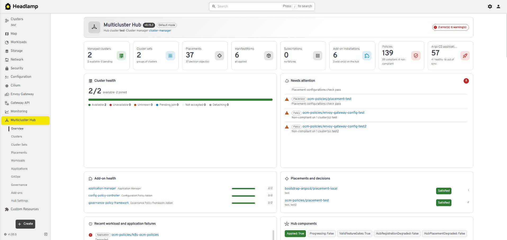

# Multicluster Hub — Headlamp plugin

[English](#english) | [Türkçe](#türkçe)

---

## English

A Headlamp plugin for operating an [Open Cluster Management](https://open-cluster-management.io)
(OCM) hub: managed clusters and their registration, cluster sets, placements, ManifestWork
distribution, add-ons, application subscriptions and the Argo CD (GitOps) integration — with
guided forms, live YAML editing and wizards for the common workflows.

### Features

**Navigation** — _Multicluster Hub_ in the sidebar with: Overview, Clusters, Cluster Sets,
Placements, Workloads, Applications, GitOps, Add-ons and Hub Settings. Each section has one
URL-backed tab per kind.

**Overview** — hub health (ClusterManager conditions, version from the image tags, feature
gates), managed clusters by state (available / unavailable / unknown / pending join / not
accepted), pending CSRs, add-on health per add-on, placements with their selected clusters,
recent ManifestWork, replica set and Subscription failures, guided workflows and an inventory of
the APIs served by the cluster.

**Platform readiness** — below the resource inventory, one card per stack of a full OCM
platform: hub control plane, cluster registration, placement, work distribution, add-on
framework, Subscriptions, Argo CD, the three GitOps models (push via GitOpsCluster v1beta1,
basic pull via argocd-pull-integration, advanced pull via argocd-agent), the policy framework,
managed service accounts, cluster proxy, the cluster inventory API (ClusterProfile) and Search
(search-v2-operator, not part of OCM). Each card lists its checks (APIs, add-on registrations and agents, feature
gates, generator ConfigMaps), the served versions, and — when something is missing — the
install commands for the detected OCM version with a link to the docs. _Rescan APIs_ re-reads
the served APIs.

**Lists and details** — sortable, filterable tables with status, cluster set, labels and age for
all 38 kinds; detail pages with readable conditions, events, a YAML section (view / edit) and
cross-references, for example:

- ManagedCluster → cluster sets, add-ons, ManifestWorks, placement decisions, pending CSRs,
  claims, taints and capacity;
- ManagedClusterSet → member clusters, bound namespaces and the placements using them;
- Placement → selection rules (with binding check), decisions → selected clusters, consumers
  (replica sets, subscriptions, GitOps clusters, add-on install strategies), live preview;
- Subscription → Channel → Placement → selected clusters → SubscriptionReport;
- ManifestWorkReplicaSet → rollout per placement → ManifestWork per cluster;
- ClusterManagementAddOn → installations per cluster.

**Forms and YAML** — create / edit forms for every writable kind with validation derived from
the CRD schemas (required fields, enums, patterns, ranges), inline help and links to the OCM
docs. The editor has Form, YAML (Monaco) and Documentation tabs that stay in sync both ways; the
documentation tab browses the live CRD schema. ClusterPermission, AddOnTemplate and Klusterlet
are YAML only.

**Governance** (shown when the policy framework is installed):

- _Policies_: root policies with compliance, inform / enforce, compliant clusters, template
  kinds and standards; detail with compliance and the latest message per cluster, placement →
  bindings → clusters, policy sets, templates (with YAML), automations and an equivalent
  **PolicyGenerator** configuration for Git. Actions: switch inform / enforce, enable / disable.
- Form with builders for **ConfigurationPolicy** (objects, compliance type, severity,
  namespaces, prune) and **OperatorPolicy** (OLM package, channel, catalog, upgrade approval),
  plus raw YAML templates for other engines; standards / categories / controls; dependencies.
  Validation includes the propagator webhook rules.
- _Policy Sets_, _Placement Bindings_, _Automations_ (Ansible) with forms; _Configuration /
  Operator Policies_ evaluated on this cluster (read only, when the hub is itself managed).
- Overview compliance card and "needs attention" entries for non-compliant policies; policies
  of each cluster on the managed cluster page; bindings listed among the users of a placement.

**Argo CD** (shown when the `argoproj.io` APIs are installed):

- _Applications_: Argo CD Applications with sync / health, push or pull model, the managed
  cluster they target (resolved through the OCM cluster secrets) and the owning ApplicationSet;
  detail with resources, sync history, conditions and — for the pull model — the ManifestWork
  that carries the application to the cluster. Actions: Refresh, Hard refresh and Sync (with
  revision, prune and dry run); pull-model hub copies have no actions.
- _ApplicationSets_: the OCM placement used by the `clusterDecisionResource` generator, the
  decided clusters, a warning for clusters not registered in Argo CD, and the generated
  applications. Form with placement, push / pull model and template.
- _GitOps_: Argo CD projects (form), an _Argo CD clusters_ tab listing the cluster secrets by
  managed cluster (metadata only, credentials are never read into the UI), and on every
  GitOpsCluster a check that compares the placement decisions with the registered clusters and
  the `acm-placement` ConfigMap.
- Overview card and "needs attention" entries for degraded, out-of-sync and failed
  applications; Argo CD section on the managed cluster page; ApplicationSets listed among the
  users of a placement.

**Wizards** (each ends with a review step showing the generated YAML):

1. _Import a cluster_ — ManagedCluster (accepted), cluster set, add-ons, `clusteradm join`
   command; then the cluster page shows the agent's CSR with an Approve button.
2. _Create a placement_ — namespace, cluster sets (creates missing bindings), label / claim /
   CEL predicates, prioritizers, tolerations, spread, preview of matching clusters.
3. _Deploy an application_ — Channel (Git / Helm / object bucket, new or existing) →
   Subscription (branch, path, chart, version) → Placement (new or existing).
4. _Configure GitOps_ — GitOpsCluster wired to an Argo CD namespace and a Placement.
5. _Distribute a workload_ — ManifestWorkReplicaSet with a placement and rollout strategy, or
   one ManifestWork per chosen cluster.
6. _Deploy with Argo CD_ — Placement in the Argo CD namespace → GitOpsCluster (reused when one
   already serves the placement; `createBlankClusterSecrets` for the pull model) →
   ApplicationSet with the OCM placement generator: push, basic pull or argocd-agent model
   (the agent model uses GitOpsCluster v1alpha1 and `destination.name`).
7. _Create a policy_ — basics and standards → ConfigurationPolicy / OperatorPolicy / YAML
   templates → placement (new or existing) → PlacementBinding; the review also shows the
   equivalent PolicyGenerator configuration.

**Actions** — accept / revoke acceptance, assign to a cluster set, detach a cluster; approve or
deny registration CSRs; enable / disable add-ons on a cluster; pause / resume a Subscription
(`subscription-pause` label); delete with confirmation. Actions are only shown when the user's
RBAC allows them (SelfSubjectAccessReview through Headlamp's `AuthVisible`).

### Screenshots

**Overview**



### Requirements

- Headlamp **0.45.0** (desktop and in-cluster), vanilla Kubernetes (no OpenShift-specific APIs are used).
- An OCM hub; sections whose APIs are missing are hidden or shown as "not installed" / "unsupported version".
- Read access to the OCM kinds is enough for the views; the extra permissions of the actions are listed in the [Permissions](#permissions) section.

### Installation

#### From the Headlamp plugin catalog (Artifact Hub)

The plugin is published on [Artifact Hub](https://artifacthub.io/packages/headlamp/batuhancikrikci-headlamp-plugins/multi-cluster). In the Headlamp desktop app, open the plugin
catalog, search for **Multicluster Hub** and install it. The catalog shows only official plugins by default; turn off **Only official plugins** in the
Plugin Catalog settings to see this plugin.

#### Manual installation

Download `multi-cluster-<version>.tar.gz` from [GitHub Releases](https://github.com/batuhancikrikci/headlamp-plugins/releases), compare its SHA-256
checksum with the `.sha256` file and extract it into the Headlamp plugins directory:

| Platform | Plugins directory                                                                                       |
| -------- | ------------------------------------------------------------------------------------------------------- |
| Linux    | `~/.config/Headlamp/plugins/` (or `~/.local/share/Headlamp/plugins/` when it exists)                    |
| macOS    | `~/Library/Application Support/Headlamp/plugins/` (otherwise `~/Library/Preferences/Headlamp/plugins/`) |
| Windows  | `%APPDATA%\Headlamp\Config\plugins\` (or `%LOCALAPPDATA%\Headlamp\Data\plugins\` when it exists)        |

```bash
tar -xzf multi-cluster-*.tar.gz -C ~/.config/Headlamp/plugins/
```

The directory must contain `multi-cluster/main.js` and `multi-cluster/package.json`. Reload Headlamp afterwards
(Ctrl+Shift+R / Cmd+Shift+R).

To confirm that the tarball was built from this repository by its release workflow, verify its
build provenance with the [GitHub CLI](https://cli.github.com):
`gh attestation verify multi-cluster-<version>.tar.gz --repo batuhancikrikci/headlamp-plugins`.

#### From source

```bash
npm ci
npm run deploy        # icons, type-check, lint, tests, build, install
```

`npm run deploy` installs the plugin into the plugins directory of the Headlamp desktop app, found
the same way `headlamp-plugin start` finds it. Set `HEADLAMP_PLUGINS_DIR` to install somewhere
else, and use `npm run deploy:fast` to skip the checks. The previous version is replaced atomically,
and the script warns about other copies of the plugin that Headlamp might load instead.

#### In-cluster Headlamp

The plugin manager of the Headlamp Helm chart can install the plugin from Artifact Hub:

```yaml
pluginsManager:
  enabled: true
  configContent: |
    plugins:
      - name: multi-cluster
        source: https://artifacthub.io/packages/headlamp/batuhancikrikci-headlamp-plugins/multi-cluster
```

Without a `version` field the latest release is installed; add `version: <x.y.z>` under `source`
to pin one.

Alternatively, extract the tarball built by `npm run package` into the directory passed to the
Headlamp server with `-plugins-dir` (`/headlamp/plugins` in the official image), from an init
container or with a custom image:

```dockerfile
FROM node:20-alpine AS build
WORKDIR /plugin
COPY package.json package-lock.json ./
RUN npm ci
COPY . .
RUN npm run build && cp package.json dist/

FROM ghcr.io/headlamp-k8s/headlamp:v0.45.0
COPY --from=build /plugin/dist /headlamp/plugins/multi-cluster
```

### Permissions

Read access to the OCM kinds is enough for the views. Creating objects needs the usual
`create` / `update` / `delete` verbs; in addition:

- accepting clusters: `patch` on `managedclusters` (and the OCM `managedclusters/accept`
  permission enforced by the hub webhook);
- approving CSRs: `update` on `certificatesigningrequests/approval` and `approve` on the signer;
- assigning a cluster to a set: `create` on `managedclustersets/join`;
- binding a set to a namespace: `create` on `managedclustersets/bind`;
- Argo CD refresh / sync: `patch` on `applications.argoproj.io`; the Argo CD cluster views list
  `secrets` with the label `argocd.argoproj.io/secret-type=cluster` (only metadata is displayed);
- the documentation tab and version-dependent fields read CRDs (`get` on
  `customresourcedefinitions`); without it they fall back to hints.

### Configuration

The plugin has no settings of its own; it works with the permissions of the Kubernetes user.

### Compatibility

| Component                                                   | Supported                                                             |
| ----------------------------------------------------------- | --------------------------------------------------------------------- |
| Headlamp                                                    | 0.45.0 (desktop and in-cluster)                                       |
| OCM core (`open-cluster-management-io/ocm`)                 | v0.14.0 – v1.3.1                                                      |
| Application lifecycle (`multicloud-operators-subscription`) | v0.14.0 – v0.16.0 and `main`                                          |
| GitOps integration (`multicloud-integrations`)              | v0.12.0 – v0.13.0 and `main`                                          |
| Policy framework (optional)                                 | governance-policy-propagator / config-policy-controller v0.14 – v0.20 |
| Argo CD (optional)                                          | v2.10 – v3.5 (`argoproj.io/v1alpha1`), push and pull model            |
| Kubernetes                                                  | vanilla Kubernetes (no OpenShift-specific APIs are used)              |

The plugin discovers the served APIs at runtime and never assumes a version. Sections whose
APIs are not installed are hidden; a tab whose kind is missing, or served only in a version the
plugin does not know, shows a clear "not installed" / "unsupported version" state. The add-on
APIs are used as `v1beta1` on OCM v1.2.0+ and as `v1alpha1` before; version-dependent form fields
(e.g. Placement CEL selectors, `sortBy`, MWRS cascade deletion) are switched on from the CRD
schema. See [docs/API_MATRIX.md](docs/API_MATRIX.md) for every kind, version and field change,
and [docs/ARCHITECTURE.md](docs/ARCHITECTURE.md) for the design.

### Development

Requires Node.js **20.11+** and npm **10+**. In the plugin directory:

```bash
npm ci
npm start             # rebuilds on every change and copies the result into the local Headlamp
```

| Command                             | What it does                                              |
| ----------------------------------- | --------------------------------------------------------- |
| `npm start`                         | Watch mode; every build is copied into the local Headlamp |
| `npm run build`                     | Production bundle in `dist/`                              |
| `npm run check`                     | Type-check, lint and unit tests                           |
| `npm run tsc`                       | Type-check (strict)                                       |
| `npm run lint` / `npm run lint-fix` | ESLint, zero warnings allowed                             |
| `npm run format`                    | Prettier                                                  |
| `npm test`                          | Vitest unit tests                                         |
| `npm run storybook`                 | Component stories                                         |
| `npm run package`                   | `multi-cluster-<version>.tar.gz` for distribution         |
| `npm run deploy` / `deploy:fast`    | Build and install into the local Headlamp desktop app     |

Icons are bundled, so the plugin works without internet access: `npm run icons` collects every
`mdi:` and `simple-icons:` id used in `src/` into `src/icons/bundle.json` (`start`, `build`,
`package` and `storybook` run it first).

`src/common/` holds the building blocks shared by every plugin of this repository (states, error
boundary, CRD documentation, form fields, editor and wizards). The copies are identical in every
plugin; `src/plugin.ts` describes this plugin to them.

#### Project layout

```text
src/
  index.tsx                 Sidebar entries, routes, kind icons
  plugin.ts                 Identity of the plugin, used by src/common
  routes.ts                 Route names
  common/                   Shared building blocks, identical in every plugin of this repository
  icons/                    Generated icon bundle
  api/                      Discovery, served versions, capabilities, kinds
  resources/                KubeObject classes, registry and pure models per area
  hooks/                    Discovery, capability and live data hooks
  readiness/                Platform readiness checks
  utils/                    Pure, unit-tested logic: validation, placement preview, wizards
  components/
    common/                 Views, CRD gate, related objects, YAML section, shared presentation
    common/form/            Selector editor, metadata fields, create / edit actions
    clusters/ clustersets/ placements/ workloads/ addons/ applications/ gitops/
    governance/ argocd/ settings/
                            Lists, details, forms and actions per sidebar section
    overview/               Overview and platform readiness
    wizards/                Guided workflows
scripts/
  build-icons.mjs           Offline icon bundle (src/icons/bundle.json)
  deploy.mjs                Build and install into the local Headlamp desktop app
```

### License

Licensed under the [Apache License 2.0](LICENSE). Third-party components and trademark notices are listed in [NOTICE](NOTICE).

This is an independent project; it is not affiliated with or endorsed by the Headlamp project or the projects it works with. Kubernetes, Headlamp, Open Cluster Management and Argo CD are trademarks of their respective owners and are used only to identify the software this plugin works with.

### Contributing

Open an [issue](https://github.com/batuhancikrikci/headlamp-plugins/issues) for bugs and ideas. The contribution guidelines are in [CONTRIBUTING.md](../CONTRIBUTING.md) and security reports are handled as described in [SECURITY.md](../SECURITY.md).

---

## Türkçe

Bir [Open Cluster Management](https://open-cluster-management.io) (OCM) hub'ını yönetmek için geliştirilen
Headlamp eklentisi; yönetilen kümeler ve kayıtları, cluster set'ler, placement'lar, ManifestWork
dağıtımı, eklentiler, uygulama abonelikleri ve Argo CD (GitOps) entegrasyonu gibi yaygın iş akışlarını
rehberli formlar, canlı YAML düzenleme ve sihirbazlarla sunar.

### Özellikler

**Gezinme** — kenar çubuğunda _Multicluster Hub_: Overview, Clusters, Cluster Sets, Placements,
Workloads, Applications, GitOps, Add-ons ve Hub Settings. Her bölümde tür başına URL'li bir sekme
vardır.

**Genel bakış** — hub sağlığı (ClusterManager koşulları, imaj etiketlerinden sürüm, feature
gate'ler), durumlarına göre yönetilen kümeler (available / unavailable / unknown / pending join / not
accepted), bekleyen CSR'lar, eklenti başına eklenti sağlığı, seçtikleri kümelerle placement'lar, son
ManifestWork, replica set ve Subscription hataları, rehberli iş akışları ve kümenin sunduğu API'lerin
envanteri.

**Platform hazırlığı (Readiness)** — kaynak envanterinin altında, eksiksiz bir OCM platformunun her katmanını ayrı bir
kart üzerinde özetler: hub kontrol düzlemi, küme kaydı, placement, iş dağıtımı, eklenti çatısı, Subscription'lar,
Argo CD, üç GitOps modeli (GitOpsCluster v1beta1 ile push, argocd-pull-integration ile basic pull,
argocd-agent ile advanced pull), policy framework, managed service account'lar, cluster proxy, küme
envanteri API'si (ClusterProfile) ve Search (search-v2-operator, OCM'nin parçası değil). Her kart
denetimlerini (API'ler, eklenti kayıtları ve agent'lar, feature gate'ler, üreteç ConfigMap'leri),
sunulan sürümleri ve bir şey eksikse tespit edilen OCM sürümüne uygun kurulum komutlarını belge
bağlantısıyla listeler. _Rescan APIs_ düğmesi sunulan API'leri yeniden tarar.

**Listeler ve detaylar** — 38 türün tamamı için durum, cluster set, etiketler ve yaşla sıralanabilir,
filtrelenebilir tablolar; okunabilir koşullar, olaylar, bir YAML bölümü (görüntüleme / düzenleme) ve
çapraz referanslar içeren detay sayfaları, örneğin:

- ManagedCluster → cluster set'ler, eklentiler, ManifestWork'ler, placement kararları, bekleyen
  CSR'lar, claim'ler, taint'ler ve kapasite;
- ManagedClusterSet → üye kümeler, bağlı namespace'ler ve onları kullanan placement'lar;
- Placement → seçim kuralları (binding kontrolüyle), kararlar → seçilen kümeler, tüketiciler (replica
  set'ler, abonelikler, GitOps kümeleri, eklenti kurulum stratejileri), canlı önizleme;
- Subscription → Channel → Placement → seçilen kümeler → SubscriptionReport;
- ManifestWorkReplicaSet → placement başına rollout → küme başına ManifestWork;
- ClusterManagementAddOn → küme başına kurulumlar.

**Formlar ve YAML** — CRD şemalarından türetilen doğrulamayla (zorunlu alanlar, enum'lar, desenler,
aralıklar), satır içi yardımla ve OCM belgelerine bağlantılarla her yazılabilir tür için oluşturma /
düzenleme formları. Editörde iki yönlü senkron Form, YAML (Monaco) ve Documentation sekmeleri vardır;
dokümantasyon sekmesi canlı CRD şemasında gezinir. ClusterPermission, AddOnTemplate ve Klusterlet yalnızca
YAML ile düzenlenir.

**Governance** (policy framework kuruluysa gösterilir):

- _Policies_: uyumluluk, inform / enforce, uyumlu kümeler, şablon türleri ve standartlarla kök
  politikalar; küme başına uyumluluk ve son mesaj, placement → binding'ler → kümeler, policy set'ler,
  şablonlar (YAML ile), otomasyonlar ve Git için eşdeğer bir **PolicyGenerator** yapılandırması
  içeren detay. Eylemler: inform / enforce geçişi, etkinleştirme / devre dışı bırakma.
- **ConfigurationPolicy** (nesneler, uyumluluk türü, önem derecesi, namespace'ler, prune) ve
  **OperatorPolicy** (OLM paketi, kanal, katalog, yükseltme onayı) oluşturucuları ile diğer motorlar
  için ham YAML şablonları içeren form; standartlar / kategoriler / kontroller; bağımlılıklar.
  Doğrulama propagator webhook kurallarını da içerir.
- Formlarıyla _Policy Sets_, _Placement Bindings_, _Automations_ (Ansible); bu kümede değerlendirilen
  _Configuration / Operator Policies_ (salt okunur, hub'ın kendisi yönetiliyorsa).
- Genel bakışta uyumluluk kartı ve uyumsuz politikalar için "dikkat gerektirenler" girdileri; yönetilen
  küme sayfasında her kümenin politikaları; bir placement'ın kullanıcıları arasında listelenen
  binding'ler.

**Argo CD** (`argoproj.io` API'leri kuruluysa gösterilir):

- _Applications_: sync / sağlık durumu, push veya pull modeli, hedefledikleri yönetilen küme (OCM küme
  Secret'ları üzerinden çözümlenir) ve sahibi ApplicationSet ile Argo CD Application'ları; kaynakları, sync
  geçmişini, koşulları ve pull modelinde uygulamayı kümeye taşıyan ManifestWork'ü gösteren detay.
  Eylemler: Refresh, Hard refresh ve Sync (revizyon, prune ve dry run ile); pull modelinin hub
  kopyalarında eylem yoktur.
- _ApplicationSets_: `clusterDecisionResource` üretecinin kullandığı OCM placement'ı, karar verilen
  kümeler, Argo CD'ye kayıtlı olmayan kümeler için uyarı ve üretilen uygulamalar. Placement, push /
  pull modeli ve şablon içeren form.
- _GitOps_: Argo CD projeleri (form), küme secret'larını yönetilen kümeye göre listeleyen bir _Argo CD
  clusters_ sekmesi (yalnızca metaveri; kimlik bilgileri arayüze hiç okunmaz) ve her GitOpsCluster'da
  placement kararlarını kayıtlı kümelerle ve `acm-placement` ConfigMap'iyle karşılaştıran bir denetim.
- Bozulmuş, senkron dışı ve başarısız uygulamalar için genel bakış kartı ve "dikkat gerektirenler"
  girdileri; yönetilen küme sayfasında Argo CD bölümü; bir placement'ın kullanıcıları arasında
  listelenen ApplicationSet'ler.

**Sihirbazlar** (her biri üretilen YAML'i gösteren bir inceleme adımıyla biter):

1. _Import a cluster_ — ManagedCluster (kabul edilmiş), cluster set, eklentiler, `clusteradm join`
   komutu; ardından küme sayfası agent'ın CSR'ını bir Approve düğmesiyle gösterir.
2. _Create a placement_ — namespace, cluster set'ler (eksik binding'leri oluşturur), etiket / claim /
   CEL koşulları, önceliklendiriciler, toleration'lar, dağılım, eşleşen kümelerin önizlemesi.
3. _Deploy an application_ — Channel (Git / Helm / nesne deposu, yeni veya var olan) → Subscription
   (dal, yol, chart, sürüm) → Placement (yeni veya var olan).
4. _Configure GitOps_ — bir Argo CD namespace'ine ve bir Placement'a bağlı GitOpsCluster.
5. _Distribute a workload_ — placement ve rollout stratejisiyle ManifestWorkReplicaSet ya da seçilen
   küme başına bir ManifestWork.
6. _Deploy with Argo CD_ — Argo CD namespace'inde Placement → GitOpsCluster (placement'a zaten hizmet
   eden varsa yeniden kullanılır; pull modeli için `createBlankClusterSecrets`) → OCM placement
   üreteçli ApplicationSet: push, basic pull veya argocd-agent modeli (agent modeli GitOpsCluster
   v1alpha1 ve `destination.name` kullanır).
7. _Create a policy_ — temel bilgiler ve standartlar → ConfigurationPolicy / OperatorPolicy / YAML
   şablonları → placement (yeni veya var olan) → PlacementBinding; inceleme ayrıca eşdeğer
   PolicyGenerator yapılandırmasını da gösterir.

**Eylemler** — kabul etme / kabulü geri alma, cluster set'e atama, kümeyi ayırma; kayıt CSR'larını
onaylama veya reddetme; bir kümede eklentileri açma / kapama; bir Subscription'ı duraklatma /
sürdürme (`subscription-pause` etiketi); onaylı silme. Eylemler yalnızca kullanıcının RBAC izni varsa
gösterilir (Headlamp'in `AuthVisible` bileşeni üzerinden SelfSubjectAccessReview).

### Ekran görüntüleri

**Genel bakış**


### Gereksinimler

- Headlamp **0.45.0** (masaüstü ve küme içi), vanilla Kubernetes (OpenShift'e özgü API kullanılmaz).
- Bir OCM hub'ı; eksik API'lerin bölümleri gizlenir ya da "kurulu değil" / "desteklenmeyen sürüm" olarak gösterilir.
- Görünümler için OCM türlerinde okuma yetkisi yeterlidir; eylemler için gereken ek yetkiler [Yetkiler](#yetkiler) bölümünde.

### Kurulum

#### Headlamp eklenti kataloğundan (Artifact Hub)

Eklenti [Artifact Hub](https://artifacthub.io/packages/headlamp/batuhancikrikci-headlamp-plugins/multi-cluster) üzerinde yayınlanır. Headlamp masaüstü uygulamasında eklenti
kataloğunu açın, **Multicluster Hub** araması yapın ve eklentiyi kurun. Katalog varsayılan olarak yalnızca resmî (official) eklentileri gösterir; bu eklentiyi görmek için
Plugin Catalog ayarlarında **Only official plugins** seçeneğini kapatın.

#### Elle kurulum

[GitHub Releases](https://github.com/batuhancikrikci/headlamp-plugins/releases) sayfasından `multi-cluster-<sürüm>.tar.gz` dosyasını indirin, SHA-256
sağlama toplamını (checksum) `.sha256` dosyasıyla doğrulayın ve Headlamp eklenti dizinine açın:

| Platform | Eklenti dizini                                                                                      |
| -------- | --------------------------------------------------------------------------------------------------- |
| Linux    | `~/.config/Headlamp/plugins/` (varsa `~/.local/share/Headlamp/plugins/`)                            |
| macOS    | `~/Library/Application Support/Headlamp/plugins/` (yoksa `~/Library/Preferences/Headlamp/plugins/`) |
| Windows  | `%APPDATA%\Headlamp\Config\plugins\` (varsa `%LOCALAPPDATA%\Headlamp\Data\plugins\`)                |

```bash
tar -xzf multi-cluster-*.tar.gz -C ~/.config/Headlamp/plugins/
```

Dizinde `multi-cluster/main.js` ve `multi-cluster/package.json` bulunmalıdır. Ardından Headlamp'i yeniden
yükleyin (Ctrl+Shift+R / Cmd+Shift+R).

Paketin bu depodaki sürüm iş akışıyla derlendiğini, derleme kaynağı kanıtını
[GitHub CLI](https://cli.github.com) ile denetleyerek doğrulayabilirsiniz:
`gh attestation verify multi-cluster-<sürüm>.tar.gz --repo batuhancikrikci/headlamp-plugins`.

#### Kaynaktan kurulum

```bash
npm ci
npm run deploy        # ikonlar, tip denetimi, lint, testler, derleme, kurulum
```

`npm run deploy` eklentiyi Headlamp masaüstü uygulamasının eklenti dizinine, `headlamp-plugin start`
ile aynı kuralla bulduğu dizine kurar. Başka bir dizin için `HEADLAMP_PLUGINS_DIR` ayarlayın;
denetimleri atlamak için `npm run deploy:fast` kullanın. Önceki sürüm atomik olarak değiştirilir ve
betik, Headlamp'in onun yerine yükleyebileceği başka kopyalar hakkında uyarır.

#### Küme içi Headlamp

Headlamp Helm chart'ının eklenti yöneticisiyle eklenti Artifact Hub'dan kurulabilir:

```yaml
pluginsManager:
  enabled: true
  configContent: |
    plugins:
      - name: multi-cluster
        source: https://artifacthub.io/packages/headlamp/batuhancikrikci-headlamp-plugins/multi-cluster
```

`version` alanı yazılmazsa en son sürüm kurulur; bir sürümü sabitlemek için `source` altına
`version: <x.y.z>` ekleyin.

Ya da `npm run package` ile üretilen tarball'ı Headlamp sunucusuna `-plugins-dir` ile verilen dizine
(resmî imajda `/headlamp/plugins`) bir init container ile veya özel bir imajla açın:

```dockerfile
FROM node:20-alpine AS build
WORKDIR /plugin
COPY package.json package-lock.json ./
RUN npm ci
COPY . .
RUN npm run build && cp package.json dist/

FROM ghcr.io/headlamp-k8s/headlamp:v0.45.0
COPY --from=build /plugin/dist /headlamp/plugins/multi-cluster
```

### Yetkiler

Görünümler için OCM türlerinde okuma yetkisi yeterlidir. Nesne oluşturmak alışılmış `create` /
`update` ve `delete` yetkilerini gerektirir; ayrıca:

- kümeleri kabul etmek: `managedclusters` üzerinde `patch` (ve hub webhook'unun uyguladığı OCM
  `managedclusters/accept` yetkisi);
- CSR onaylamak: `certificatesigningrequests/approval` üzerinde `update` ve imzalayıcı üzerinde
  `approve`;
- bir kümeyi set'e atamak: `managedclustersets/join` üzerinde `create`;
- bir set'i namespace'e bağlamak: `managedclustersets/bind` üzerinde `create`;
- Argo CD refresh / sync: `applications.argoproj.io` üzerinde `patch`; Argo CD küme görünümleri
  `argocd.argoproj.io/secret-type=cluster` etiketli `secrets` nesnelerini listeler (yalnızca
  metaveri gösterilir);
- belge sekmesi ve sürüme bağlı alanlar CRD'leri okur (`customresourcedefinitions` üzerinde `get`);
  yetki yoksa ipuçlarına geri dönülür.

### Yapılandırma

Eklentinin ayrı bir yapılandırması yoktur; Kubernetes kullanıcısının yetkileriyle çalışır.

### Uyumluluk

| Bileşen                                                      | Desteklenen                                                           |
| ------------------------------------------------------------ | --------------------------------------------------------------------- |
| Headlamp                                                     | 0.45.0 (masaüstü ve küme içi)                                         |
| OCM core (`open-cluster-management-io/ocm`)                  | v0.14.0 – v1.3.1                                                      |
| Uygulama yaşam döngüsü (`multicloud-operators-subscription`) | v0.14.0 – v0.16.0 ve `main`                                           |
| GitOps entegrasyonu (`multicloud-integrations`)              | v0.12.0 – v0.13.0 ve `main`                                           |
| Policy framework (isteğe bağlı)                              | governance-policy-propagator / config-policy-controller v0.14 – v0.20 |
| Argo CD (isteğe bağlı)                                       | v2.10 – v3.5 (`argoproj.io/v1alpha1`), push ve pull modeli            |
| Kubernetes                                                   | vanilla Kubernetes (OpenShift'e özgü API kullanılmaz)                 |

Eklenti sunulan API'leri çalışma zamanında keşfeder ve hiçbir sürümü varsaymaz. API'leri kurulu
olmayan bölümler gizlenir; türü eksik ya da yalnızca eklentinin bilmediği bir sürümde sunulan bir
sekme açık bir "kurulu değil" / "desteklenmeyen sürüm" durumu gösterir. Add-on API'leri OCM v1.2.0+
üzerinde `v1beta1`, öncesinde `v1alpha1` olarak kullanılır; sürüme bağlı form alanları (örneğin
Placement CEL seçicileri, `sortBy`, MWRS cascade silme) CRD şemasına göre açılır. Her tür, sürüm ve
alan değişikliği için [docs/API_MATRIX.md](docs/API_MATRIX.md), tasarım için
[docs/ARCHITECTURE.md](docs/ARCHITECTURE.md) dosyasına bakın.

### Geliştirme

Node.js **20.11+** ve npm **10+** gerekir. Eklenti dizininde:

```bash
npm ci
npm start             # her değişiklikte derler ve sonucu yerel Headlamp'e kopyalar
```

| Komut                               | Ne yapar                                             |
| ----------------------------------- | ---------------------------------------------------- |
| `npm start`                         | İzleme modu; her derleme yerel Headlamp'e kopyalanır |
| `npm run build`                     | `dist/` altında üretim paketi                        |
| `npm run check`                     | Tip denetimi, lint ve birim testleri                 |
| `npm run tsc`                       | Tip denetimi (strict)                                |
| `npm run lint` / `npm run lint-fix` | ESLint, sıfır uyarı                                  |
| `npm run format`                    | Prettier                                             |
| `npm test`                          | Vitest birim testleri                                |
| `npm run storybook`                 | Bileşen hikâyeleri                                   |
| `npm run package`                   | Dağıtım için `multi-cluster-<sürüm>.tar.gz`          |
| `npm run deploy` / `deploy:fast`    | Derleyip yerel Headlamp masaüstüne kurar             |

İkonlar pakete gömülüdür, eklenti internet erişimi olmadan çalışır: `npm run icons`, `src/` içinde
kullanılan her `mdi:` ve `simple-icons:` kimliğini `src/icons/bundle.json` dosyasına toplar
(`start`, `build`, `package` ve `storybook` komutları öncelikli olarak bu adımı çalıştırır).

`src/common/` bu depodaki tüm eklentilerde ortak olan yapı taşlarını içerir (durum ekranları, hata
yakalama, CRD dokümantasyonu, form alanları, editör ve sihirbazlar). Kopyalar her eklentide tamamen
aynıdır; `src/plugin.ts` bu eklentiyi onlara tanıtır.

#### Dosya yapısı

```text
src/
  index.tsx                 Kenar çubuğu girdileri, rotalar, tür ikonları
  plugin.ts                 Eklentinin kimliği (src/common tarafından kullanılır)
  routes.ts                 Rota adları
  common/                   Ortak yapı taşları, bu depodaki tüm eklentilerde tamamen aynı
  icons/                    Üretilen ikon paketi
  api/                      Keşif, sunulan sürümler, yetenekler, türler
  resources/                KubeObject sınıfları, kayıt defteri ve alan başına saf modeller
  hooks/                    Keşif, yetenek ve canlı veri hook'ları
  readiness/                Platform hazırlık denetimleri
  utils/                    Saf, birim testli mantık: doğrulama, placement önizlemesi, sihirbazlar
  components/
    common/                 Görünümler, CRD kapısı, ilgili nesneler, YAML bölümü, ortak sunum
    common/form/            Seçici editörü, metaveri alanları, oluşturma / düzenleme eylemleri
    clusters/ clustersets/ placements/ workloads/ addons/ applications/ gitops/
    governance/ argocd/ settings/
                            Kenar çubuğu bölümü başına listeler, detaylar, formlar ve eylemler
    overview/               Genel bakış ve platform hazırlığı
    wizards/                Rehberli iş akışları
scripts/
  build-icons.mjs           Çevrimdışı ikon paketi (src/icons/bundle.json)
  deploy.mjs                Derler ve yerel Headlamp masaüstüne kurar
```

### Lisans

[Apache License 2.0](LICENSE) ile lisanslanmıştır. Üçüncü taraf bileşenler ve marka bildirimleri [NOTICE](NOTICE) dosyasındadır.

Bu bağımsız bir projedir; Headlamp projesiyle ya da birlikte çalıştığı projelerle bağlantılı değildir ve onlar tarafından onaylanmamıştır. Kubernetes, Headlamp, Open Cluster Management ve Argo CD ilgili sahiplerinin ticari markalarıdır; yalnızca eklentinin birlikte çalıştığı yazılımı tanımlamak için kullanılır.

### Katkıda bulunma

Hata bildirimleri ve öneriler için [issue](https://github.com/batuhancikrikci/headlamp-plugins/issues) açın. Katkı kuralları [CONTRIBUTING.md](../CONTRIBUTING.md), güvenlik bildirimleri [SECURITY.md](../SECURITY.md) içindedir.
